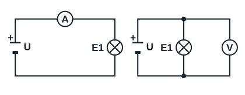

## Les appareils de mesure de l'électricien

| Appareil | Grandeur mesurée | Unité | Branchement |
|---|---|---|---|
| Ampèremètre | Intensité du courant qui traverse un équipement | ampère (A) | En série dans le circuit |
| Voltmètre | Tension entre deux points | volt (V) | En parallèle (en dérivation) aux bornes de l'équipement |
| Ohmmètre | Résistance, par exemple celle d'une bobine | ohm (Ω) | Aux bornes de l'élément, **circuit hors tension** |
| Capacimètre | Capacité d'un condensateur | farad (F), en pratique microfarad (µF) | Condensateur débranché et déchargé |
| Multimètre | Regroupe plusieurs fonctions : tension, intensité, résistance, continuité, parfois capacité | selon la fonction | Selon la fonction choisie |
| Pince ampèremétrique | Intensité, sans ouvrir le circuit | ampère (A) | La pince entoure un seul conducteur |
| Détecteur de tension sans contact | Présence de la phase | aucune | Approché du conducteur, il signale la phase par un son ou un voyant |

*À gauche, l'ampèremètre A est placé en série : tout le courant de la lampe E1 le traverse. À droite, le voltmètre V est branché en parallèle aux bornes de la lampe.*

## Règles d'utilisation

- Avant chaque mesure avec un multimètre, choisir la fonction et le calibre adaptés à la grandeur mesurée. En cas de doute, commencer par le calibre le plus élevé.
- Raccorder la sonde noire à la borne COM, la sonde rouge à la borne qui correspond à la fonction (V/Ω ou A).
- L'ohmmètre et le capacimètre s'utilisent toujours sur un élément **hors tension** : l'appareil fournit lui-même le courant de mesure. Brancher un ohmmètre sur un circuit alimenté fausse la mesure et peut détruire l'appareil.
- Un condensateur peut rester chargé après la coupure : le décharger avant de le toucher ou de le mesurer.
