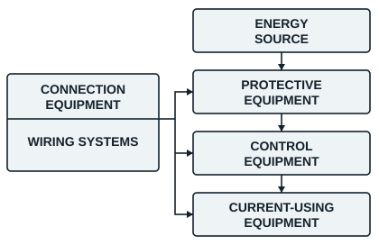

## Target competence

Learners will be able to design the complete electrical installation of a residential building that meets the best conditions of safety and operation.

## Introduction

Designing the electrical installation of a new home follows strict rules, to keep the occupants safe and the equipment working properly. This module is a practical guide to the key stages: planning, dividing the circuits (lighting and socket outlets), choosing the protective devices in line with the standard, and wiring the circuits.

## The stages of sizing an electrical installation

Sizing a domestic electrical installation comes down to seven preliminary stages:

1. Draw the layout plan of the equipment in each room.
2. Draw the matching single-line diagram (schéma unifilaire).
3. Draw the single-line connection diagram and position the electricity meter.
4. Calculate the total installed power of the house.
5. Determine the rating of the protective devices to install in the consumer unit.
6. Size the incoming Eneo cables (or those of another supplier) according to the power and the distance.
7. Write the specification or the quotation for the materials needed.

## General overview of an electrical installation

Every electrical installation can be broken down as follows.

| Block | Examples |
|---|---|
| Energy source | Batteries, cells, alternator, DC generator, Eneo mains supply |
| Protective equipment | Fuses, circuit breakers, thermal relays, magnetic relays |
| Control equipment | Switches, push buttons, changeover switches, contactors, relays |
| Current-using equipment | Motors, heaters, lamps |
| Connection equipment | Terminal blocks, connector strips, connectors, socket outlets and plugs |
| Wiring systems | Wires and cables, busbars, conduits |
