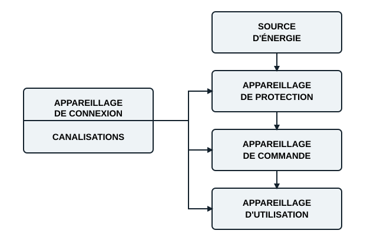

## Compétence visée

L'apprenant sera capable de concevoir l'installation électrique complète d'un bâtiment résidentiel qui réponde aux conditions de sécurité et de fonctionnement optimales.

## Introduction

La conception de l'installation électrique d'une habitation neuve obéit à des règles strictes, pour assurer la sécurité des occupants et le bon fonctionnement des équipements. Ce module est un guide pratique des étapes clés : la planification, la répartition des circuits (éclairage et prises de courant), le choix des dispositifs de protection conformément à la norme, et le câblage des différents circuits.

## Les étapes du dimensionnement d'une installation électrique

Les étapes préalables au dimensionnement d'une installation électrique domestique se résument à sept :

1. Établir le plan d'implantation des équipements des différentes pièces.
2. Réaliser le schéma unifilaire correspondant à ce plan.
3. Établir le schéma de raccordement unifilaire et positionner le compteur d'énergie électrique.
4. Calculer la puissance totale installée dans la maison.
5. Déterminer le calibre des protections à installer dans le tableau.
6. Dimensionner les câbles d'arrivée Eneo (ou d'un autre distributeur) en fonction de la puissance et de la distance.
7. Rédiger le cahier des charges ou le devis du matériel nécessaire à l'installation.

## Synopsis général d'une installation électrique

Toute installation électrique peut se décomposer de la façon suivante.

| Bloc | Exemples |
|---|---|
| Source d'énergie | Accumulateurs, piles, alternateur, génératrice à courant continu, réseau Eneo |
| Appareillage de protection | Fusibles, disjoncteurs, relais thermiques, relais magnétiques |
| Appareillage de commande | Interrupteurs, boutons-poussoirs, commutateurs, contacteurs, relais |
| Appareillage d'utilisation | Moteurs, radiateurs, lampes |
| Appareillage de connexion | Bornes de jonction, barrettes, connecteurs, prises et fiches |
| Canalisations | Fils et câbles, barres, conduits |
