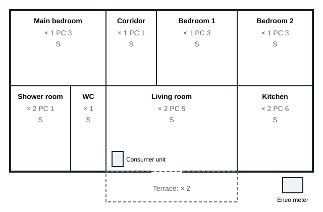

## Stage 1: the layout plan

The layout plan places, room by room, every lighting point, every socket outlet and every switch. It is drawn on the architect's plan using architectural symbols (see module 3). The standard **NF C 15-100** (IEC 60364) sets a **minimum** level of equipment per room: the client can always ask for more.

| Room | Lighting (minimum) | 16 A socket outlets (minimum) | Other |
|---|---|---|---|
| Living room | 1 switched point | 1 per 4 m², at least 5 | Data outlet (RJ45) |
| Bedroom | 1 switched point | 3 | Data outlet |
| Kitchen | 1 switched point | 6, including 4 above the worktop | Dedicated circuits: hob, oven, dishwasher |
| Shower room | 1 switched point | 1, outside zones 0, 1 and 2 | Supplementary bonding of metal parts |
| WC | 1 switched point | none | |
| Hall, corridor | 1 switched point | 1 if the area exceeds 4 m² | Push button or two-way switching at each end |

Installation rules to remember:

- Socket outlets are at least **5 cm** above the floor (centre of the contacts), and **8 cm** above a worktop.
- Switches are placed at the entrance to the room, on the side the door opens, between 0.90 m and 1.30 m above the floor.
- In the shower room, no socket outlet in zones 0, 1 and 2; equipment there must have the required IP rating.
- All socket outlets are **shuttered** and connected to the protective conductor (2P+E).

## Example: single-storey house

The plan below shows a single-storey, three-bedroom house like the one in the handout. Each room shows its equipment: **×** lighting point, **PC** socket outlets, **S** switch.

The consumer unit is near the entrance, in a service duct; the Eneo meter is at the property boundary, accessible from outside.
