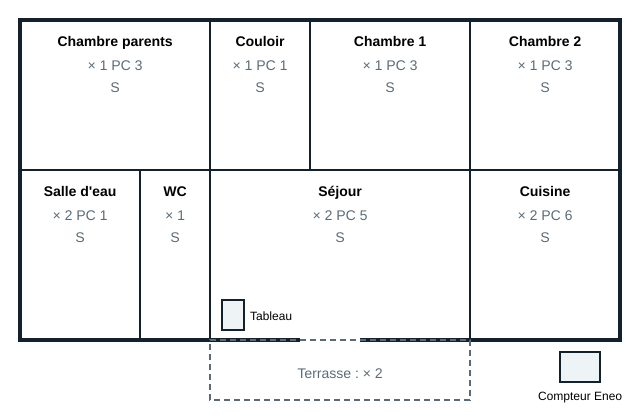

## Étape 1 : le plan d'implantation

Le plan d'implantation place, pièce par pièce, chaque point d'éclairage, chaque prise de courant et chaque commande. Il se dessine sur le plan de l'architecte avec les symboles architecturaux (voir le module 3). La norme **NF C 15-100** fixe un équipement **minimal** par pièce : le client peut toujours demander davantage.

| Pièce | Éclairage (minimum) | Prises de courant 16 A (minimum) | Autres |
|---|---|---|---|
| Séjour | 1 point commandé | 1 par tranche de 4 m², au moins 5 | Prise de communication (RJ45) |
| Chambre | 1 point commandé | 3 | Prise de communication |
| Cuisine | 1 point commandé | 6, dont 4 au-dessus du plan de travail | Circuits spécialisés : plaque de cuisson, four, lave-vaisselle |
| Salle d'eau | 1 point commandé | 1, hors des volumes 0, 1 et 2 | Liaison équipotentielle des éléments métalliques |
| WC | 1 point commandé | aucune | |
| Couloir, entrée | 1 point commandé | 1 si la surface dépasse 4 m² | Bouton-poussoir ou va-et-vient aux extrémités |

Règles de pose à retenir :

- Les prises de courant sont à **5 cm au moins** du sol (axe des alvéoles), à **8 cm** au-dessus d'un plan de travail.
- Les interrupteurs se placent à l'entrée de la pièce, côté ouverture de la porte, entre 0,90 m et 1,30 m du sol.
- Dans la salle d'eau, aucune prise dans les volumes 0, 1 et 2 ; l'appareillage y respecte l'indice de protection imposé.
- Toutes les prises de courant sont à **éclipse** et reliées au conducteur de protection (2P+T).

## Exemple : maison de plain-pied

Le plan ci-dessous reprend une maison de plain-pied de trois chambres, comme celle du support. Chaque pièce indique son équipement : **×** point d'éclairage, **PC** prises de courant, **S** commande.

Le tableau de répartition est placé près de l'entrée, dans une gaine technique ; le compteur Eneo est en limite de propriété, accessible depuis l'extérieur.
