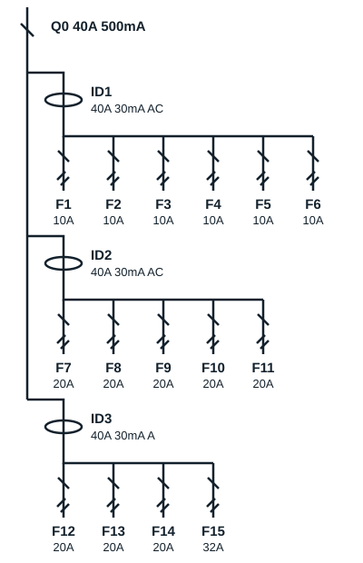

## Stages 2 and 3: the single-line diagram of the consumer unit

A single-line diagram shows each circuit as a single line, whatever the number of conductors; short oblique strokes on the line give that number. It reads from top to bottom: Eneo supply, meter, main incoming circuit breaker, residual current devices, then miniature circuit breakers and circuits.

The diagram below is the one drawn on the board in class for the three-bedroom house.

| Reference | Protection | Cross-section | Circuit |
|---|---|---|---|
| Q0 | Main incoming circuit breaker 40 A, 500 mA | | Eneo supply |
| ID1 | RCD 40 A, 30 mA, type AC | | Lighting |
| F1 | 10 A | 1.5 mm² | Lighting, main bedroom and entrance |
| F2 | 10 A | 1.5 mm² | Lighting, kitchen and dining room |
| F3 | 10 A | 1.5 mm² | Lighting, bedroom 2 |
| F4 | 10 A | 1.5 mm² | Lighting, bedroom 1 |
| F5 | 10 A | 1.5 mm² | Lighting, living room |
| F6 | 10 A | 1.5 mm² | Lighting, shower room and WC |
| ID2 | RCD 40 A, 30 mA, type AC | | Socket outlets |
| F7 | 20 A | 2.5 mm² | Sockets, living room |
| F8 | 20 A | 2.5 mm² | Sockets, bedroom 1 |
| F9 | 20 A | 2.5 mm² | Sockets, main bedroom |
| F10 | 20 A | 2.5 mm² | Sockets, bedroom 2 |
| F11 | 20 A | 2.5 mm² | Sockets, kitchen |
| ID3 | RCD 40 A, 30 mA, type A | | Dedicated circuits |
| F12 | 20 A | 2.5 mm² | Air conditioner, main bedroom |
| F13 | 20 A | 2.5 mm² | Air conditioner, living room |
| F14 | 20 A | 2.5 mm² | Washing machine |
| F15 | 32 A | 6 mm² | Hob |

## What the standard says

- **RCD sensitivity**: 500 mA for the supplier's main circuit breaker; 300 mA protects against fire; **30 mA protects people** and is required on every circuit of a dwelling.
- **Type**: type AC for lighting and sockets; type A for the washing machine and hob circuits, whose electronics produce leakage currents with a DC component.
- **RCD rating**: with a supply of 45 A or less, each RCD is rated at least 40 A.
- **Lighting**: 1.5 mm², circuit breaker of 16 A at most, no more than 8 lighting points per circuit.
- **16 A sockets**: 2.5 mm² with a 20 A circuit breaker (12 sockets at most), or 1.5 mm² with 16 A (8 sockets at most).
- **Dedicated circuits**: one circuit per large appliance (washing machine, air conditioner, water heater, oven); 6 mm² and 32 A for the hob.
