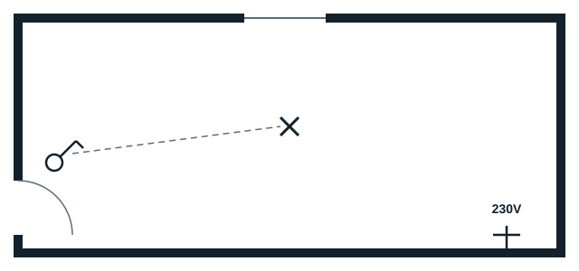
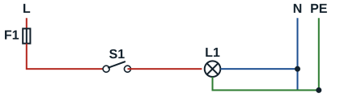

The same installation is shown by several diagrams, each with its own purpose.

## Architectural plan

Drawn by the architect with the client, it shows where the equipment and the supply points are. The electrician works from it: it is an **installation drawing**. The dotted line is a **control link**: it shows which switch controls which light point.

## Wiring diagram

Drawn by the electrician, it explains **how the circuit works** (schéma développé). It is an explanatory diagram, used mainly for **fault finding**. Its symbols differ from those of the architectural plan, and each device has an **alphanumeric reference** giving its type and its rank in the installation: F1 for the protective device, S1 for the switch, L1 for the lamp.

## Single-line diagram

Drawn by the electrician from the multi-line diagram, it is an installation drawing that shows all the conductors of one wiring run as **a single line**; short oblique strokes give their number. It makes dense installations easier to read.

## Installation plan

Drawn by the electrician from the architectural plan, it is an installation drawing that shows the **exact route of the conductors**, their number in each conduit and their colours. For one-way switching: three conductors (line, neutral, earth) from the consumer unit to the junction box; two (line and switch wire) to the switch; three (switch wire, neutral, earth) to the light point.
