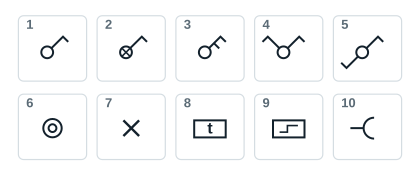
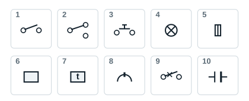

## Standard symbols for architectural plans

| No. | Designation |
|---|---|
| 1 | One-way switch |
| 2 | Illuminated one-way switch |
| 3 | Double-pole one-way switch |
| 4 | Double switch (two-gang) |
| 5 | Two-way switch |
| 6 | Push button |
| 7 | Lighting point |
| 8 | Staircase timer |
| 9 | Impulse relay |
| 10 | Socket outlet (general symbol) |

Other symbols in the handout: the illuminated push button (crossed circle inside the double circle), the fluorescent batten (line ending in two bars), the control link (dotted line between the switch and the light point). Special socket outlets carry a letter: TP telephone, TV television, HP loudspeakers.

## Standard symbols for wiring diagrams

| No. | Designation |
|---|---|
| 1 | One-way switch |
| 2 | Two-way switch (changeover) |
| 3 | Push button |
| 4 | Lamp |
| 5 | Fuse |
| 6 | Impulse relay or contactor coil |
| 7 | Timer coil (time-delayed) |
| 8 | Socket outlet |
| 9 | Circuit breaker |
| 10 | Capacitor |
