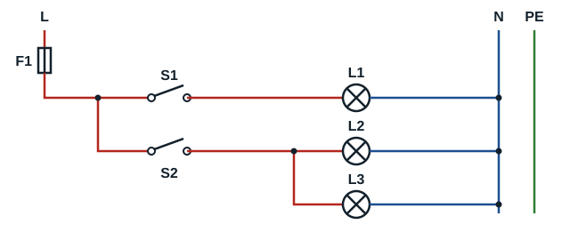
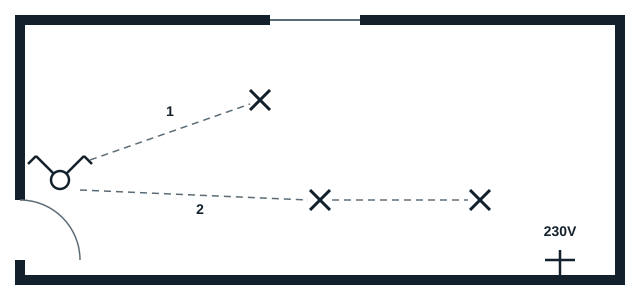

## Protection

| Wire cross-section | Lighting points at most | Protection | Circuit |
|---|---|---|---|
| 1.5 mm² | 8 | 10 A (fuse) to 16 A (circuit breaker) | Lighting |

## Wiring diagram

Switch S1 supplies lamp L1 (circuit 1); switch S2 supplies lamps L2 and L3 (circuit 2). All conductors are 1.5 mm².

## Architectural plan

## Layout on the wiring board

On the practice board, the protection enclosure (F1 and the supply) is at the bottom, the junction box (BD) at the top left, the switch in the centre, and the three lamps around them: lamp 1 at the top, lamp 2 at the bottom, lamp 3 on the side. The conductors run in the trunking that links these points.
