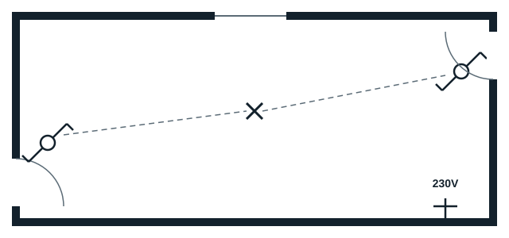
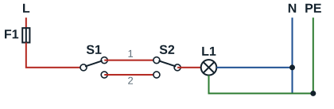

## Architectural plan

## Wiring diagram

**Key**: F1 circuit breaker; S1 and S2 two-way switches; 1 and 2 strappers; L1 lamp.

## Multi-line diagram

The multi-line diagram shows each conductor and its actual route between the consumer unit, the junction box, the two switches and the lamp. In the junction box: the line goes to the common terminal of S1; the two strappers run from S1 to S2; the common terminal of S2 returns to the lamp; the neutral and the earth go straight to the lamp. The handout also shows, on the same board, a socket outlet P1 supplied by its own 20 A circuit.

## Symbol

| Designation | Architectural symbol | Wiring diagram symbol |
|---|---|---|
| Two-way switch | Circle with two opposite inclined strokes (one up, one down) | Changeover contact: one common terminal and two strapper terminals |
