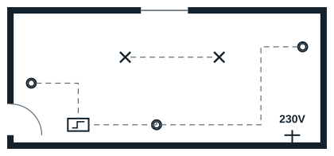
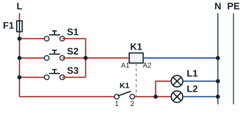

## Plan architectural

## Schéma développé

**Légende** : F1 protection ; S1 à S3 boutons-poussoirs ; K1 télérupteur (bobine A1-A2, contact 1-2) ; L1 et L2 lampes.

## Matériel

| Désignation | Symbole architectural | Symbole développé |
|---|---|---|
| Bouton-poussoir | Double cercle (un cercle barré au centre s'il est lumineux) | Contact à fermeture avec poussoir |
| Télérupteur modulaire | Rectangle contenant un créneau | Bobine K1 et contact K1, voir le schéma |
