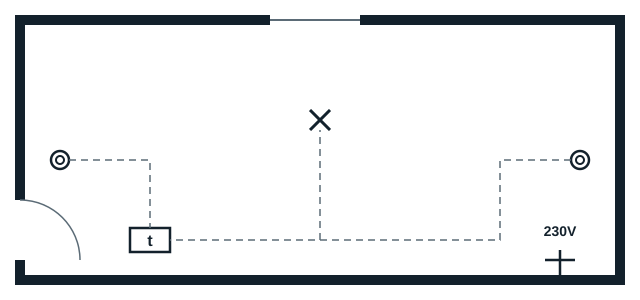
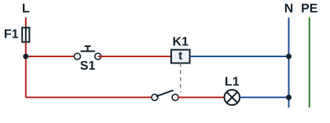
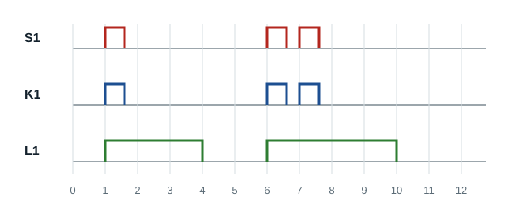

## Rôle

La minuterie avec effet commande l'allumage, l'extinction étant automatique après un temps prédéfini. **Un nouvel appui sur le bouton-poussoir relance la temporisation.**

## Schéma architectural

## Schéma développé

## Étude temporelle

La temporisation est réglée sur 3 secondes. Le bouton-poussoir S1 est actionné à 1 s, puis à 6 s et à 7 s.

| Moment | Ce qui se passe |
|---|---|
| 1 s | Appui : la lampe s'allume pour 3 s |
| 4 s | Fin de la temporisation : la lampe s'éteint |
| 6 s | Appui : la lampe s'allume |
| 7 s | Nouvel appui : la temporisation **repart** pour 3 s |
| 10 s | La lampe s'éteint (7 + 3) |

**Remarque** : chaque nouvelle action sur le bouton-poussoir relance la temporisation.
