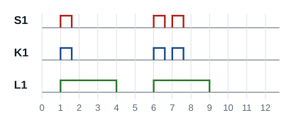

## Rôle

La minuterie sans effet commande l'allumage, l'extinction étant automatique après un temps prédéfini. **Un nouvel appui sur le bouton-poussoir ne relance pas la temporisation.** Le schéma développé est le même que celui de la minuterie avec effet : seul le comportement de l'appareil change.

## Étude temporelle

Mêmes réglages : temporisation de 3 secondes, appuis à 1 s, 6 s et 7 s.

| Moment | Ce qui se passe |
|---|---|
| 1 s | Appui : la lampe s'allume pour 3 s |
| 4 s | La lampe s'éteint |
| 6 s | Appui : la lampe s'allume |
| 7 s | Nouvel appui : **sans effet** |
| 9 s | La lampe s'éteint (6 + 3) |

**Remarque** : un nouvel appui sur le bouton-poussoir avant la fin de la temporisation est sans effet.

## Variante : forçage et inhibition

Certaines minuteries électroniques modulaires ont un commutateur à trois positions :

- **fonctionnement normal** : la minuterie obéit aux boutons-poussoirs ;
- **forçage** : les lampes restent allumées en permanence (pour un nettoyage ou un déménagement, par exemple) ;
- **inhibition** (position 0) : la minuterie ne fonctionne plus, les boutons-poussoirs sont sans effet.

Plusieurs boutons-poussoirs (BP1, BP2, BP3) sont raccordés **en parallèle** sur l'entrée de commande.
