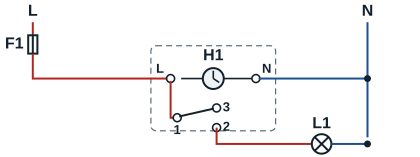
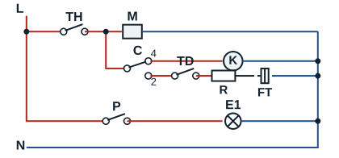

## Lighting

The motor of time switch H1 is permanently supplied between L and N. Its contact (common terminal 1) closes to terminal 2 during the programmed periods and supplies lamp L1. The circuit is protected by a 16 A circuit breaker; the time switch contact carries 16 A at most.

## Frost-free refrigerator

In a frost-free (no frost) refrigerator, the defrost timer alternates two phases: cooling, then defrosting the evaporator.

| Reference | Role |
|---|---|
| TH | Cabinet thermostat: switches the circuit on when the compartment is too warm |
| M | Defrost timer motor |
| C | Timer contact: to 4 for cooling, to 2 for defrosting |
| K | Compressor (with its starting relay and overload protector) |
| R | Evaporator defrost heater |
| TD | Defrost termination thermostat: cuts the heater once the evaporator is clear |
| FT | Safety thermal fuse (about 72 °C) |
| E1, P | Interior lamp and door switch |

The evaporator fan, supplied in parallel with the compressor, is not shown.
