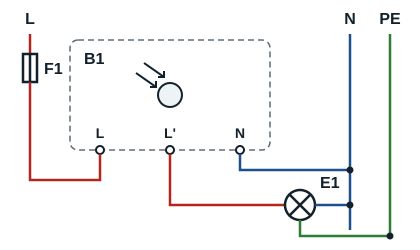
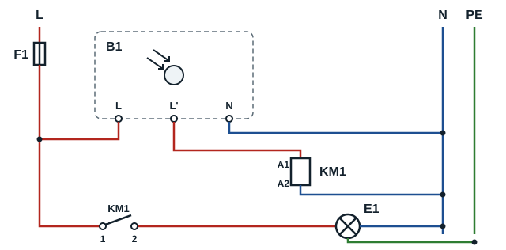

## Compétence visée

À la fin de ce module, l'apprenant doit être capable de :

- définir un interrupteur crépusculaire et un capteur de mouvement ;
- expliquer leur principe de fonctionnement ;
- identifier les bornes de raccordement et les éléments de réglage ;
- comprendre les schémas de câblage de principe ;
- effectuer les réglages et diagnostiquer les pannes courantes.

## Définition

Un interrupteur crépusculaire est un appareil qui commande automatiquement un éclairage en fonction de la luminosité ambiante. Il utilise généralement une cellule photosensible.

## Principe de fonctionnement

- Lorsque la luminosité diminue, l'appareil commande l'allumage de la lampe au seuil réglé.
- Lorsque la luminosité augmente, l'appareil commande généralement l'extinction de la lampe.

Certains modèles possèdent une temporisation ou une hystérésis afin d'éviter les commutations répétées lors de variations momentanées de lumière.

## Applications

- Éclairage de cours, jardins et allées
- Éclairage de rues et parkings
- Éclairage de façades et enseignes
- Éclairage extérieur de bâtiments

## Bornes courantes

| Borne | Désignation | Fonction habituelle |
|---|---|---|
| L | Phase | Alimentation de l'appareil |
| N | Neutre | Alimentation de l'appareil |
| L' / OUT | Sortie commandée | Commande de la lampe |
| PE | Terre | Protection du luminaire |

**Important** : le repérage varie selon les fabricants. Certains modèles ont trois fils, d'autres quatre fils ou davantage. Toujours suivre le schéma de la notice. Une sortie à contact sec se câble différemment d'une sortie délivrant une phase commutée.

## Schémas de principe

Alimentation 230 V. L'interrupteur crépusculaire B1 est alimenté entre L et N ; sa sortie L' alimente la lampe E1, dont l'autre borne revient au neutre. Le conducteur de protection PE est raccordé au luminaire.

Pour un éclairage extérieur puissant (plusieurs projecteurs), la sortie de B1 alimente la bobine A1-A2 d'un relais ou d'un contacteur KM1 ; c'est le contact 1-2 de KM1 qui alimente les lampes. Vérifier dans la notice la puissance admissible par la sortie de l'appareil.

| Repère | Rôle |
|---|---|
| F1 | Disjoncteur de protection du circuit |
| B1 | Interrupteur crépusculaire (cellule photosensible) |
| KM1 | Relais ou contacteur : bobine A1-A2, contact 1-2 |
| E1 | Lampe ou luminaire |

## Raccordement

1. Couper l'alimentation, consigner le circuit et vérifier l'absence de tension.
2. Raccorder la phase protégée à L et le neutre à N, si le modèle le demande.
3. Raccorder la sortie commandée à la borne de phase de la lampe.
4. Raccorder l'autre borne de la lampe au neutre.
5. Raccorder le conducteur de protection (PE), présent à chaque point d'éclairage, à la borne de terre du luminaire de classe I (NF C 15-100).

## Réglage

**Seuil de luminosité** : le réglage du seuil détermine à quel niveau de luminosité l'éclairage doit s'allumer ou s'éteindre. Un seuil plus élevé provoque généralement l'allumage alors qu'il fait encore relativement clair ; un seuil plus bas attend une obscurité plus importante. Le comportement exact dépend du modèle.

**Temporisation** : lorsqu'elle est disponible, la temporisation retarde la commutation afin de limiter les réactions aux variations brèves de luminosité.

**Procédure de réglage**

1. Vérifier le câblage et les protections conformément à la notice.
2. Régler le seuil lumineux selon le besoin.
3. Effectuer un essai de détection de l'obscurité en suivant la notice.
4. Vérifier l'allumage puis l'extinction lorsque la luminosité augmente.
5. Ajuster le réglage si nécessaire.
