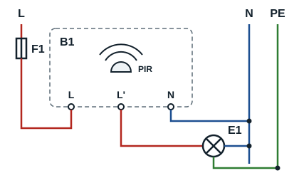
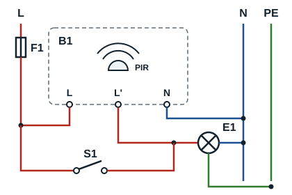

## Definition

A motion detector (capteur de mouvement) senses the movement of a person or an object in a given area and can switch a lamp. The usual models for lighting use passive infrared (PIR) technology, which detects changes in infrared radiation.

## How it works

- When movement is detected, the output switches the lamp on.
- The lamp stays on for the set time.
- If no further movement is detected, it switches off at the end of the time delay.

Some models restart the time delay at each new detection.

## Uses

- Corridors and stairs
- Entrances, garages and car parks
- Toilets and rooms people pass through
- Paths and outdoor lighting

## Common terminals

| Terminal | Name | Usual function |
|---|---|---|
| L | Line | Supplies the detector |
| N | Neutral | Supplies the detector and sometimes the lamp |
| L' / OUT | Output | Switched line to the lamp |

This table applies to a 230 V model with a switched-line output. Check the manufacturer's diagram before making any connection. As with the twilight switch, the protective conductor (PE) is taken to the luminaire.

## Basic diagrams

The motion detector B1 is connected like the twilight switch: L and N for the supply, output L' to the lamp E1, return to neutral, PE to the luminaire.

A switch S1 connected in parallel between L and output L' forces the lamp on, for example during maintenance: when closed, it supplies the lamp whatever the detection.

| Mark | Role |
|---|---|
| F1 | Circuit breaker protecting the circuit |
| B1 | Passive infrared (PIR) motion detector |
| S1 | Override switch (permanently on) |
| E1 | Lamp or luminaire |

## Operation

1. With no movement, the output stays inactive after the time delay.
2. When movement is detected, the detector switches the lamp on.
3. After the last detection, the time delay starts or restarts, depending on the model.
4. At the end of the set time, the lamp switches off if no new movement is detected.

## Settings

| Setting | Meaning | Role |
|---|---|---|
| TIME | Duration | How long the lamp stays on after a detection |
| LUX | Light level | Allows or limits operation according to the ambient light |
| SENS | Sensitivity | Adjusts the sensitivity or the effective detection range |

**Practical procedure**

1. Switch off the supply and check that the circuit is dead before touching any conductor.
2. Check the connections against the model's instructions.
3. Close the housing before switching the supply back on.
4. Set TIME to a short duration for testing.
5. Set LUX for the required operation, then adjust SENS.
6. Test the area by walking to different places and correct the settings.
