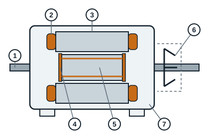

## Target competence

The learner will be able to describe an electric motor, explain how it works and tell the different types of motors apart. The learner will also be able to read any motor rating plate and connect the windings of three-phase induction motors in the different ways.

## What is an electric motor?

An electric motor is an electromechanical machine that converts electrical energy into rotating mechanical energy.

## The different types of motors

There are several types of electric motors, in particular:

- alternating current (AC) motors:
  - asynchronous or induction motors;
  - synchronous motors;
- direct current (DC) motors.

**Note**: in this module we only study AC motors.

## The parts of an electric motor

An electric motor is made of two clearly separate parts:

- a fixed part called the **stator**: the frame carrying the laminated core (stacked steel sheets) and the windings;
- a moving part called the **rotor**: the shaft and the rotor core, which turn inside the stator.

The air space between the stator and the rotor is called the **air gap**.

### Construction of an induction motor

| Mark | Part | Role |
|---|---|---|
| 1 | Shaft | Transmits the rotation to the driven machine |
| 2 | Stator winding | Creates the magnetic field when it is supplied |
| 3 | Stator core | Stacked sheets that carry the magnetic field |
| 4 | Squirrel cage (cage d'écureuil) | Rotor bars joined by two end rings, carrying the induced currents |
| 5 | Rotor core | Stacked sheets that hold the cage |
| 6 | Fan | Cools the motor |
| 7 | Frame | Supports and protects the whole motor |

### Parts seen on a dismantled motor

| Part | Role |
|---|---|
| Frame (often aluminium or cast iron) | Holds the stator, gets rid of heat through its fins |
| Front and rear end shields | Close the frame and hold the bearings |
| Bearings | Guide the rotating shaft |
| Shaft seals | Keep dust and water out |
| Fan cover | Protects the fan |
| Terminal box and terminal board | Receive the supply cables and the connection links |
| Mounting feet | Fix the motor to its base |
| Rating plate | Gives the rated characteristics of the motor |

## What is the difference between an induction motor and a synchronous motor?

A motor is called **synchronous** when the rotor turns as fast as the rotating field created by the stator, and **asynchronous** (induction) when the rotor turns slightly slower than that field.

Physically, the difference between an induction motor and a synchronous motor lies in the **rotor**. The rotor of a synchronous motor is a magnet or an electromagnet, often wound, whereas the rotor of an induction motor is made of bars joined by rings, forming what is called the squirrel cage.

Induction motors are everywhere in our trade: circulators, pumps, refrigeration compressor motors, fans, and so on.
