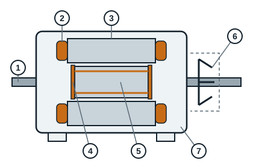

## Compétence visée

L'apprenant sera capable de décrire un moteur électrique, de donner son principe de fonctionnement et de faire la distinction entre les différents types de moteurs. Il sera aussi capable de décoder toute plaque signalétique d'un moteur électrique et de réaliser les différents couplages des enroulements des moteurs asynchrones triphasés.

## Qu'est-ce qu'un moteur électrique ?

Un moteur électrique est une machine électromécanique capable de transformer l'énergie électrique en énergie mécanique de rotation.

## Les différents types de moteurs

Il existe plusieurs types de moteurs électriques, notamment :

- les moteurs électriques à courant alternatif :
  - les moteurs asynchrones ou à induction ;
  - les moteurs synchrones ;
- les moteurs à courant continu.

**NB** : dans le cadre de ce module, nous nous limiterons à l'étude des moteurs électriques à courant alternatif.

## Les composants d'un moteur électrique

Un moteur électrique est constitué de deux parties bien distinctes :

- une partie fixe appelée **stator** : la carcasse qui porte le noyau feuilleté (tôles empilées) et les enroulements ;
- une partie mobile appelée **rotor** : l'arbre et le noyau du rotor, qui tournent à l'intérieur du stator.

L'espace d'air qui sépare le stator du rotor s'appelle l'**entrefer**.

### Construction d'un moteur asynchrone

| Repère | Élément | Rôle |
|---|---|---|
| 1 | Arbre | Transmet le mouvement de rotation à la machine entraînée |
| 2 | Enroulement du stator | Crée le champ magnétique quand il est alimenté |
| 3 | Noyau du stator | Tôles empilées qui canalisent le champ magnétique |
| 4 | Cage d'écureuil | Barres du rotor reliées par deux anneaux, parcourues par les courants induits |
| 5 | Noyau du rotor | Tôles empilées qui portent la cage |
| 6 | Ventilateur | Refroidit le moteur |
| 7 | Châssis (carcasse) | Supporte et protège l'ensemble |

### Pièces visibles sur un moteur démonté

| Pièce | Rôle |
|---|---|
| Carcasse (souvent en aluminium ou en fonte) | Porte le stator, dissipe la chaleur par ses ailettes |
| Flasques avant et arrière | Ferment la carcasse et portent les roulements |
| Roulements | Guident l'arbre en rotation |
| Joints d'étanchéité de l'arbre | Empêchent l'entrée de poussière et d'eau |
| Capot de ventilateur | Protège le ventilateur |
| Boîte à bornes et plaque à bornes | Reçoivent les câbles d'alimentation et les barrettes de couplage |
| Pattes de fixation | Fixent le moteur sur son support |
| Plaque signalétique | Donne les caractéristiques nominales du moteur |

## Quelle est la différence entre un moteur asynchrone et un moteur synchrone ?

On parle de moteur **synchrone** lorsque le rotor tourne aussi vite que le champ tournant créé par le stator, et de moteur **asynchrone** lorsque le rotor tourne un peu moins vite que ce champ.

Sur le plan physique, la différence entre un moteur asynchrone et un moteur synchrone se trouve au niveau du **rotor**. Le rotor d'un moteur synchrone se compose d'un aimant ou d'un électroaimant, souvent bobiné, alors que le rotor d'un moteur asynchrone se compose de barres reliées par des anneaux qui forment ce qu'on appelle la cage d'écureuil.

Les moteurs asynchrones sont très nombreux dans notre profession : circulateurs, pompes, moteurs des compresseurs frigorifiques, ventilateurs, etc.
