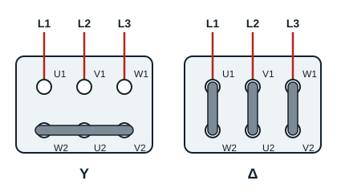

## How a three-phase induction motor works

The wound stator has 3 coils (windings) which create 3 magnetic fields. Because the coils are supplied by a three-phase system of currents, each creates a varying magnetic field. Together the three fields make a **rotating magnetic field**. This field induces currents in the rotor cage, and the action of the field on those currents creates an electromagnetic force that drives the rotor round.

## Connecting a three-phase induction motor

The 3 windings of a three-phase induction motor must be connected together and to the three-phase supply. The two possible connections are **star (Y)** (étoile) and **delta (Δ)** (triangle). The choice depends on:

- the supply voltages;
- the information on the rating plate, which gives the normal (rated) operating conditions.

## Choosing the connection

The rating plate of a three-phase induction motor always shows two voltages, for example 230/400 V.

1. If the **lower** voltage on the rating plate matches the line voltage of the supply, use the **delta Δ** connection.
2. If the **higher** voltage on the rating plate matches the line voltage of the supply, use the **star Y** connection.

**Example**: a 230/400 V motor on a supply with a 400 V line voltage is connected in star; the same motor on a supply with a 230 V line voltage is connected in delta.

## The links on the terminal board

The six ends of the three windings come to the terminal board (plaque à bornes): U1, V1, W1 at the top, W2, U2, V2 at the bottom. The connection is made with links:

- **star**: a single link joins the three bottom terminals (W2, U2, V2); they form the star point;
- **delta**: three vertical links join each top terminal to the one below it (U1 to W2, V1 to U2, W1 to V2).

To remember it: **3 links = delta**.

