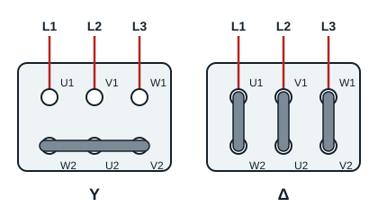

## Principe de fonctionnement d'un moteur asynchrone triphasé

Le stator bobiné est composé de 3 bobines (enroulements) qui créent 3 champs magnétiques. Ces bobines étant alimentées par un système de courants triphasés, chacune crée un champ magnétique variable. La composition de ces trois champs magnétiques crée un **champ magnétique tournant**. Ce champ induit des courants dans la cage du rotor, et l'action du champ sur ces courants crée une force électromagnétique qui entraîne le rotor en rotation.

## Couplage d'un moteur asynchrone triphasé

Les 3 bobines d'un moteur asynchrone triphasé doivent être couplées et raccordées au réseau triphasé. Les deux couplages possibles sont **étoile (Y)** et **triangle (Δ)**. Le choix du couplage dépend :

- des tensions du réseau ;
- des indications portées sur la plaque signalétique, qui donnent les conditions normales de fonctionnement (conditions nominales).

## Détermination du couplage

La plaque signalétique d'un moteur asynchrone triphasé indique toujours deux tensions, par exemple 230/400 V.

1. Si la **plus petite** tension de la plaque signalétique correspond à la tension entre phases du réseau, on choisit le couplage **triangle Δ**.
2. Si la **plus grande** tension de la plaque signalétique correspond à la tension entre phases du réseau, on choisit le couplage **étoile Y**.

**Exemple** : un moteur 230/400 V raccordé à un réseau dont la tension entre phases est 400 V se couple en étoile ; le même moteur raccordé à un réseau dont la tension entre phases est 230 V se couple en triangle.

## Les barrettes de la plaque à bornes

Les six extrémités des trois enroulements arrivent sur la plaque à bornes : U1, V1, W1 en haut, W2, U2, V2 en bas. Le couplage se fait avec des barrettes :

- **étoile** : une seule barrette relie les trois bornes du bas (W2, U2, V2) ; elles forment le point neutre de l'étoile ;
- **triangle** : trois barrettes verticales relient chaque borne du haut à la borne placée sous elle (U1 à W2, V1 à U2, W1 à V2).

Pour s'en souvenir : **3 barrettes = triangle**.

[[figure:couplage]]
