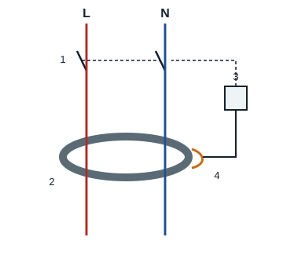

## Circuit protection devices

Every electrical network must be protected against **short circuits** and **overloads**. These faults always cause an abnormal rise in current which, if it is not limited, can become dangerous for the installation.

## The fuse

A fuse (fusible) is a device made of a conducting wire that melts and opens the circuit when the current exceeds the maximum value the wire can carry.

- **Role**: protect electrical circuits against short circuits and overloads.
- **Use**: fuses are fitted in all control circuits, and in power circuits that have no motor or whose motor is protected by a protective relay.

A fuse is not reliable protection against short or long overloads, so on its own it is not suitable for a motor.

## The circuit breaker

A circuit breaker (disjoncteur) is an electromechanical device that can make, carry and break currents under normal conditions and, above all, under abnormal conditions. Once the fault has been cleared, you simply reset it by hand with its toggle. There are thermal-magnetic circuit breakers and residual current devices.

### The thermal-magnetic circuit breaker (MCB)

Its front shows: the brand, range and reference, the tripping **curve** (B, C or D), the **rating** (rated current, for example 16 A) and the **breaking capacity** (short-circuit current it can break). The connection terminals are at the top and bottom.

### The residual current device (RCD)

The phase and neutral conductors pass through a **magnetic toroid**. As long as the current leaving through the phase comes back through the neutral, their effects cancel out. If a phase touches the metal part of an earthed appliance, some current flows to earth: the detection coil wound on the toroid senses the imbalance and drives the electromagnet, which opens the main poles. The RCD protects people provided the installation has an earth electrode.

- **Use**: it is valid protection for control and power circuits; its main drawback is its high cost.

## The contactor-breaker

A contactor-breaker (discontacteur) is an assembly of a contactor and a thermal, magnetic or thermal-magnetic protective relay.

## The magnetic relay

The magnetic relay is a trip device with, on each phase, a coil carrying the circuit current. On a short circuit, the high current pulls in the plunger (or armature) of the coil, which opens a normally closed auxiliary contact in the control circuit.

## The thermal overload relay

The thermal overload relay (relais thermique) protects the motor against **overloads**. On each phase it has a **bimetal strip** heated by the current drawn by the motor. When the current stays above the set value for too long, the strips bend and switch the auxiliary contacts:

- the normally closed contact **95-96** (NC) opens and cuts the control circuit;
- the normally open contact **97-98** (NO) closes and can light a fault lamp.

| Part | Role |
|---|---|
| Phase inputs (1/L1, 3/L2, 5/L3) | Current coming from the contactor |
| Phase outputs (2/T1, 4/T2, 6/T3) | Supply to the motor |
| Setting dial | Sets the tripping current (rated current of the motor) |
| Test button | Simulates a trip |
| Stop button | Opens contact 95-96 |
| Auto/manual reset | Choice of reset once cooled down |

## The thermal-magnetic relay

It combines a thermal trip, a magnetic trip and a normally closed auxiliary contact.

- **Use**: thermal-magnetic relays are only used in motor power circuits; they are a cheaper alternative to a circuit breaker.
