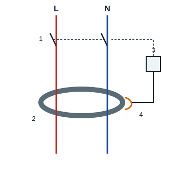

## Éléments de protection des circuits

Chaque réseau électrique doit être protégé contre les **courts-circuits** et les **surcharges**. En effet, ces défauts entraînent toujours une augmentation anormale du courant qui, si elle n'est pas limitée, peut devenir dangereuse pour les installations.

## Le fusible

C'est un appareil composé d'un fil conducteur qui, grâce à sa fusion, ouvre le circuit lorsque l'intensité du courant dépasse la valeur maximale supportée par ce fil.

- **Rôle** : assurer la protection des circuits électriques contre les courts-circuits et les surcharges.
- **Utilisation** : la protection par fusible est installée dans tous les circuits de commande, et dans les circuits de puissance qui ne possèdent pas de moteur ou dont le moteur est protégé par un relais de protection.

En effet, un fusible n'est pas une protection sûre contre les surcharges de courte ou de longue durée : il ne convient donc pas seul pour un moteur.

## Le disjoncteur

Le disjoncteur est un appareil électromécanique capable d'établir, de supporter et d'interrompre des courants dans les conditions normales, mais surtout dans les conditions anormales. Après élimination du défaut, il suffit de le réarmer par une action manuelle sur la manette. On distingue les disjoncteurs magnétothermiques et les disjoncteurs différentiels.

### Le disjoncteur magnétothermique

Sa face avant porte : la marque, la gamme et la référence, la **courbe** de déclenchement (B, C ou D), le **calibre** (courant assigné, par exemple 16 A) et le **pouvoir de coupure** (courant de court-circuit qu'il peut couper). Les bornes de connexion sont en haut et en bas.

### Le disjoncteur différentiel

Les conducteurs de phase et de neutre traversent un **tore magnétique**. Tant que le courant qui part par la phase revient par le neutre, leurs effets s'annulent. Si une phase touche la partie métallique d'un appareil raccordée à la terre, une partie du courant s'écoule par la terre : la bobine de détection enroulée sur le tore voit ce déséquilibre et commande l'électroaimant, qui ouvre les pôles principaux. Le disjoncteur différentiel joue son rôle de protection des personnes si l'installation comporte une prise de terre.

- **Utilisation** : c'est une protection valable pour les circuits de commande et de puissance ; son inconvénient majeur est son prix de revient élevé.

## Le discontacteur

C'est un ensemble d'appareils regroupant un contacteur et un relais de protection thermique, magnétique ou magnétothermique.

## Le relais magnétique

Le relais magnétique est un déclencheur composé, sur chaque phase, d'une bobine parcourue par le courant du circuit. En cas de court-circuit, le fort courant attire le noyau plongeur (ou l'armature) de la bobine, qui ouvre un contact auxiliaire à ouverture placé dans le circuit de commande.

## Le relais thermique

Le relais thermique est un déclencheur qui protège le moteur contre les **surcharges**. Il comprend, sur chaque phase, un **bilame** chauffé par le courant absorbé par le moteur. Quand le courant dépasse longtemps la valeur réglée, les bilames se déforment et font basculer les contacts auxiliaires :

- le contact à ouverture **95-96** (NC) s'ouvre et coupe le circuit de commande ;
- le contact à fermeture **97-98** (NO) se ferme et peut allumer un voyant de défaut.

| Élément | Rôle |
|---|---|
| Entrées des phases (1/L1, 3/L2, 5/L3) | Arrivée du courant venant du contacteur |
| Sorties des phases (2/T1, 4/T2, 6/T3) | Départ vers le moteur |
| Molette de réglage | Réglage du courant de déclenchement (intensité nominale du moteur) |
| Bouton test | Simule un déclenchement |
| Bouton stop | Ouvre le contact 95-96 |
| Réarmement auto/manuel | Choix du réarmement après refroidissement |

## Le relais magnétothermique

Il regroupe un déclencheur thermique, un déclencheur magnétique et un contact auxiliaire à ouverture.

- **Utilisation** : la protection par relais magnétothermique n'est utilisée que dans les circuits de puissance de moteur ; elle remplace avantageusement un disjoncteur du point de vue du prix de revient.
