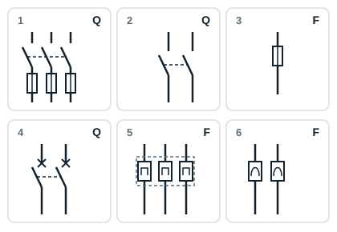
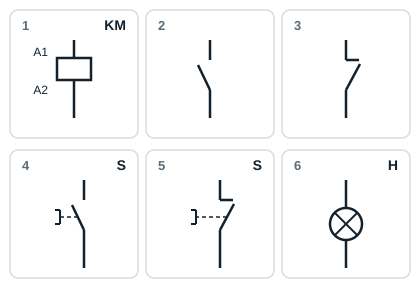

## Table of industrial electrical equipment and its uses

| Family | Function | Equipment | Uses |
|---|---|---|---|
| Transformer | Step the voltage down or up | Distribution transformer | Industrial |
| Isolators | Separate the installation from its supply | Single-pole or three-pole fuse holder; three-pole isolator | Industrial |
| Fuses | Protect property | Fuses | Domestic and industrial |
| Circuit breakers | Protect property | Two-pole circuit breaker | Domestic |
| Circuit breakers | Protect property | Three-pole circuit breaker; four-pole RCD | Industrial |
| Protective relays | Protect property | Thermal overload relay; magnetic relay | Industrial |
| Dialogue devices | Give a start command | Start push button | Industrial |
| Dialogue devices | Give a stop command | Stop push button | Industrial |
| Dialogue devices | Signal | Indicator lamps | Industrial |
| Connection accessories | Connect the conductors | Screw-screw terminal blocks; protective conductor terminal block; plug-in terminal block | Industrial |
| Connection accessories | Connect the conductors | Socket outlet | Domestic |
| Pre-actuators | Manual control | One-pole or two-pole switch; changeover switch; two-way switch | Domestic |
| Pre-actuators | Manual control | Three-pole switch | Industrial |
| Pre-actuators | Non-manual control | Relay; three-pole contactor | Industrial |
| Actuators | Convert energy | Three-phase motor; lamps; heating elements | Domestic and industrial |

## Equipment letter codes in circuit diagrams

| Code | Device |
|---|---|
| Q | Isolator, switch, circuit breaker |
| F | Fuse, protective relay |
| KM | Contactor |
| KA | Auxiliary relay |
| S | Push button, control switch, limit switch |
| H | Indicator lamp |
| M | Motor |
| E | Lamp, heating element |
| T | Transformer |
| X | Terminal block |

## Symbols of protective devices

| No. | Symbol |
|---|---|
| 1 | Three-pole fuse switch-disconnector (Q) |
| 2 | Two-pole switch (Q) |
| 3 | Fuse (F) |
| 4 | Two-pole circuit breaker (Q) |
| 5 | Three-pole thermal overload relay (F) |
| 6 | Magnetic relay (F) |

## Symbols of control and dialogue devices

| No. | Symbol |
|---|---|
| 1 | Contactor coil, terminals A1-A2 (KM) |
| 2 | Normally open contact (NO) |
| 3 | Normally closed contact (NC) |
| 4 | Start push button, normally open (S) |
| 5 | Stop push button, normally closed (S) |
| 6 | Indicator lamp (H) |
