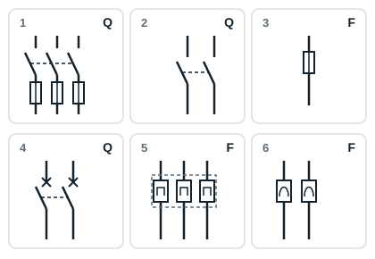
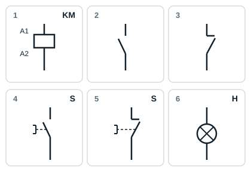

## Tableau des appareillages électriques industriels et de leurs applications

| Famille | Fonction | Appareillage | Applications |
|---|---|---|---|
| Transformateur | Abaisser ou élever la tension | Transformateur de distribution | Industrielles |
| Sectionneurs | Isoler l'installation électrique de son réseau | Porte-fusibles unipolaire ou tripolaire ; sectionneur tripolaire | Industrielles |
| Fusibles | Protéger les biens | Fusibles | Domestiques et industrielles |
| Disjoncteurs | Protéger les biens | Disjoncteur bipolaire | Domestiques |
| Disjoncteurs | Protéger les biens | Disjoncteur tripolaire ; disjoncteur différentiel tétrapolaire | Industrielles |
| Relais de protection | Protéger les biens | Relais thermique ; relais magnétique | Industrielles |
| Éléments de dialogue | Donner un ordre de marche | Bouton poussoir marche | Industrielles |
| Éléments de dialogue | Donner un ordre d'arrêt | Bouton poussoir arrêt | Industrielles |
| Éléments de dialogue | Signaler | Voyants | Industrielles |
| Auxiliaires de raccordement | Connecter les conducteurs | Borniers vissé-vissé ; bornier de conducteur de protection ; bornier débrochable | Industrielles |
| Auxiliaires de raccordement | Connecter les conducteurs | Prise de courant | Domestiques |
| Préactionneurs | Commander à la main | Interrupteur unipolaire ou bipolaire ; commutateur ; va-et-vient | Domestiques |
| Préactionneurs | Commander à la main | Interrupteur tripolaire | Industrielles |
| Préactionneurs | Commander autrement qu'à la main | Relais ; contacteur tripolaire | Industrielles |
| Actionneurs | Convertir l'énergie | Moteur triphasé ; lampes ; résistances chauffantes | Domestiques et industrielles |

## Repères des appareils dans les schémas

| Repère | Appareil |
|---|---|
| Q | Sectionneur, interrupteur, disjoncteur |
| F | Fusible, relais de protection |
| KM | Contacteur |
| KA | Relais auxiliaire |
| S | Bouton poussoir, interrupteur de commande, butée de fin de course |
| H | Voyant |
| M | Moteur |
| E | Lampe, résistance chauffante |
| T | Transformateur |
| X | Bornier |

## Symboles des appareils de protection

| N° | Symbole |
|---|---|
| 1 | Sectionneur porte-fusibles tripolaire (Q) |
| 2 | Interrupteur bipolaire (Q) |
| 3 | Fusible (F) |
| 4 | Disjoncteur bipolaire (Q) |
| 5 | Relais thermique tripolaire (F) |
| 6 | Relais magnétique (F) |

## Symboles des appareils de commande et de dialogue

| N° | Symbole |
|---|---|
| 1 | Bobine de contacteur, bornes A1-A2 (KM) |
| 2 | Contact à fermeture (NO) |
| 3 | Contact à ouverture (NC) |
| 4 | Bouton poussoir marche, à fermeture (S) |
| 5 | Bouton poussoir arrêt, à ouverture (S) |
| 6 | Voyant (H) |
