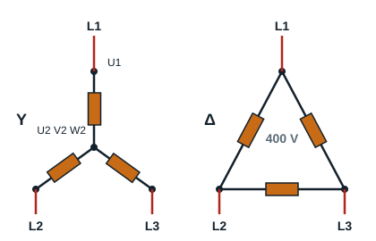

## Course outline

- Statement of the expected competences
- Check of prerequisites
- Practical scenario
- Theory
- Practice
- Task: consolidation exercise

## Expected competences

At the end of this module, the learner will be able to wire a direct-on-line starter for a three-phase induction motor with one direction of rotation.

## Check of prerequisites

### What is a three-phase induction motor?

A three-phase induction motor is a motor whose rotor does not turn exactly at the speed of the rotating field created by the supply: it turns slightly slower. This difference, called **slip**, is what allows currents to be induced in the rotor.

Revise the following notions:

- three-phase current at 230 V, 400 V, 690 V;
- rotating field;
- rotor;
- stator;
- windings of three-phase motors.

### Which starting methods are most used?

There are several ways of starting three-phase induction motors, chosen according to their power and how they are used:

- direct-on-line starting (one or two directions of rotation);
- star-delta starting;
- starting by cutting out stator or rotor resistors;
- electronic starting.

### Connecting three-phase induction motors

There are two ways of connecting three-phase induction motors, chosen according to the motor's characteristics: delta Δ and star Y. The rating plate of a three-phase induction motor always shows two possible operating voltages. The lower value is the rated voltage of one winding (one phase of the motor).

- **Delta Δ connection**: when the line voltage (tension composée) of the supply equals the lower operating voltage. Example: 400/690 V motor on a 230/400 V supply. Each winding receives the line voltage, 400 V.
- **Star Y connection**: when the line voltage of the supply equals the higher operating voltage. Example: 230/400 V motor on a 230/400 V supply. Each winding receives 400 / √3 = 230 V.

