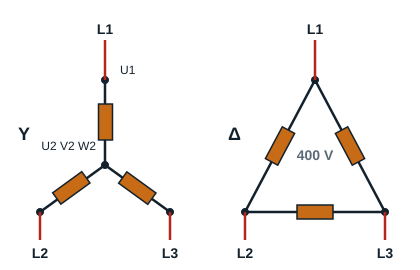

## Plan du cours

- Énoncé des compétences attendues
- Vérification des prérequis
- Mise en situation
- Contenu théorique
- Pratique
- TAF : exercice de consolidation

## Compétences attendues

Au sortir de ce module, l'apprenant devra être capable de réaliser le câblage pour un démarrage direct d'un moteur asynchrone triphasé avec un sens de marche.

## Vérification des prérequis

### Qu'est-ce qu'un moteur asynchrone triphasé ?

Un moteur asynchrone triphasé est un moteur dont le rotor ne tourne pas exactement à la vitesse du champ tournant créé par la tension d'alimentation : il tourne un peu moins vite. C'est ce décalage, appelé **glissement**, qui permet aux courants d'être induits dans le rotor.

Rappel des notions de :

- courant triphasé 230 V, 400 V, 690 V ;
- champ tournant ;
- rotor ;
- stator ;
- enroulements des moteurs triphasés.

### Quels sont les procédés de démarrage les plus utilisés ?

Il existe plusieurs procédés de démarrage des moteurs asynchrones triphasés, choisis en fonction de leur puissance et de l'utilisation que l'on en fait :

- démarrage direct (un sens ou deux sens de marche) ;
- démarrage étoile-triangle ;
- démarrage par élimination des résistances statoriques ou rotoriques ;
- démarrages électroniques.

### Couplage des moteurs asynchrones triphasés

Il existe deux types de couplage des moteurs asynchrones triphasés, choisis en fonction des caractéristiques du moteur : le couplage triangle Δ et le couplage étoile Y. La plaque signalétique d'un moteur asynchrone triphasé indique toujours deux tensions de fonctionnement possibles. La plus petite valeur indiquée est la tension nominale d'un enroulement (une phase du moteur).

- **Couplage triangle Δ** : lorsque la tension entre phases (tension composée) du réseau est égale à la plus basse tension de fonctionnement. Exemple : moteur 400/690 V sur un réseau 230/400 V. Chaque enroulement reçoit la tension entre phases, 400 V.
- **Couplage étoile Y** : lorsque la tension entre phases du réseau est égale à la plus haute tension de fonctionnement. Exemple : moteur 230/400 V sur un réseau 230/400 V. Chaque enroulement reçoit 400 / √3 = 230 V.

