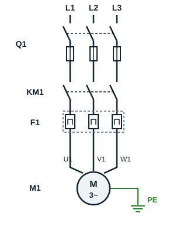
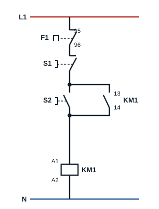

## Principle

With this method, the induction motor is connected straight to the supply and starts in a single step.

**Use**: kept for low-power motors (below 5 kW).

## Power and control circuits

We decide to start a three-phase induction motor semi-automatically, in one direction, with push button **S2** to start and push button **S1** to stop.

### Key

| Code | Device |
|---|---|
| Q1 | Fuse switch-disconnector |
| KM1 | Contactor |
| F1 | Thermal overload relay |
| S1 | Stop push button |
| S2 | Start push button |
| M1 | Three-phase induction motor |

The power chain of a direct-on-line (DOL) starter (démarrage direct) always follows the same order: isolating and short-circuit protection device, contactor, thermal overload relay, motor.

## Operation

Pressing **S2** energises the coil of contactor **KM1**, which closes. Its auxiliary contact 13-14, wired in parallel with S2, keeps the coil energised when S2 is released: this is the **hold-in (self-holding) contact** (auto-maintien). The motor starts.

Pressing **S1** stops the motor by cutting the coil supply. On an overload, contact 95-96 of thermal overload relay **F1** opens and also stops the motor.

## Advantages and drawbacks of this starting method

**Advantages**

- Simple control equipment
- High starting torque
- Fast start

**Drawbacks**

- Very high current peak at switch-on (4 to 8 times the rated current)
- Abrupt start
