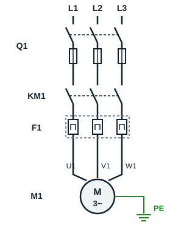
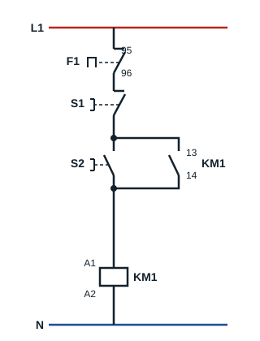

## Principe

Dans ce procédé de démarrage, le moteur asynchrone est directement branché au réseau d'alimentation et le démarrage s'effectue en un seul temps.

**Utilisation** : réservé aux moteurs de petites puissances (inférieures à 5 kW).

## Schémas de puissance et de commande

On décide de faire un démarrage d'un moteur asynchrone triphasé de manière semi-automatique, un sens de marche, avec un bouton poussoir **S2** pour la marche et un bouton poussoir **S1** pour l'arrêt.

### Légende

| Repère | Appareil |
|---|---|
| Q1 | Sectionneur porte-fusibles |
| KM1 | Contacteur |
| F1 | Relais thermique de protection |
| S1 | Bouton poussoir arrêt |
| S2 | Bouton poussoir marche |
| M1 | Moteur asynchrone triphasé |

La chaîne de puissance d'un démarreur direct (en anglais *direct-on-line starter*, DOL) suit toujours le même ordre : appareil de sectionnement et de protection contre les courts-circuits, contacteur, relais thermique, moteur.

## Fonctionnement

Une impulsion sur **S2** alimente la bobine du contacteur **KM1**, qui se ferme. Son contact auxiliaire 13-14, placé en parallèle sur S2, maintient la bobine alimentée quand on relâche S2 : c'est l'**auto-maintien**. Le moteur démarre.

L'arrêt est obtenu par une impulsion sur **S1**, qui coupe l'alimentation de la bobine. En cas de surcharge, le contact 95-96 du relais thermique **F1** s'ouvre et arrête aussi le moteur.

## Avantages et inconvénients de ce type de démarrage

**Avantages**

- Simplicité de l'appareillage de commande
- Couple de démarrage important
- Démarrage rapide

**Inconvénients**

- Pointe de courant très élevée lors de la mise sous tension (4 à 8 fois le courant nominal)
- Démarrage brusque
