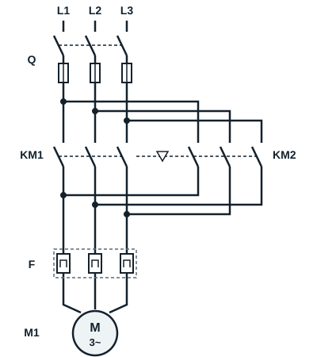
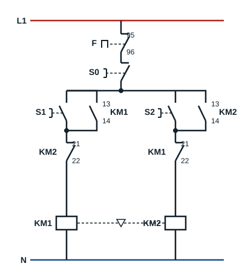

## Target competence

The learner will be competent in starting a three-phase induction motor in both directions of rotation. The motor stops when push button **S0** is pressed, runs in direction 1 when push button **S1** is pressed and in direction 2 when push button **S2** is pressed.

## Reversing the direction of rotation

To reverse a three-phase induction motor, simply **swap two phases** of its supply: the rotating field changes direction, and the rotor follows it.

## Power circuit

| Code | Device |
|---|---|
| L1, L2, L3 | Three-phase supply |
| Q | Fuse switch-disconnector |
| KM1 | Main contactor, direction 1 |
| KM2 | Main contactor, direction 2 |
| F | Thermal overload relay |
| M1 | Three-phase induction motor |

KM1 connects L1, L2, L3 to terminals U1, V1, W1 in order. KM2 connects L1 to U1, but **L3 to V1 and L2 to W1**: two phases are swapped. The two contactors must never be closed at the same time, otherwise phases L2 and L3 are short-circuited. They are therefore joined by a **mechanical interlock** (▽ symbol between KM1 and KM2) which prevents one from closing while the other is closed. This arrangement is called a reversing starter (inverseur de sens de marche).

## Control circuit

| Code | Device |
|---|---|
| Q | Isolator (early-break contact) |
| F | Thermal overload relay (contact 95-96) |
| S0 | Stop push button |
| S1 | Start push button, direction 1 |
| S2 | Start push button, direction 2 |
| KM1, KM2 | Main contactors |
| KM1 (13-14), KM2 (13-14) | Hold-in contacts |
| KM1 (21-22), KM2 (21-22) | Electrical interlock contacts |

The hold-in contact 13-14 of each contactor is wired in parallel with its start button. The normally closed contact 21-22 of **KM2** is wired in series with the coil of **KM1**, and contact 21-22 of **KM1** in series with the coil of **KM2**: this is the **electrical interlock** (verrouillage électrique). While one contactor is closed, the other cannot be energised.

## Operation

- Pressing push button **S1** energises the coil of contactor **KM1**, which closes its power contacts.
- Motor terminals U1, V1 and W1 are supplied by phases L1, L2 and L3 respectively: the motor runs forwards (clockwise).
- Pressing push button **S0** stops the motor.
- Pressing push button **S2** energises contactor **KM2**: U1 is connected to L1, V1 to L3 and W1 to L2. The motor is supplied with two phases swapped: it runs in reverse (anticlockwise).

To change direction, press **S0** first: the electrical interlock stops KM2 from pulling in while KM1 is closed.
