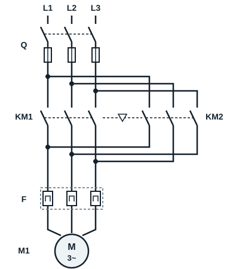
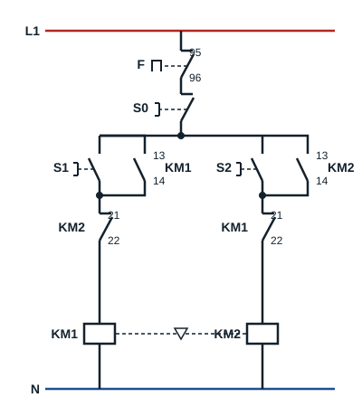

## Compétence visée

L'apprenant sera compétent pour démarrer un moteur asynchrone triphasé dans deux sens de rotation. L'arrêt s'effectue en appuyant sur le bouton poussoir **S0**, la mise en marche dans le sens 1 en appuyant sur le bouton poussoir **S1** et la mise en marche dans le sens 2 en appuyant sur le bouton poussoir **S2**.

## Inverser le sens de rotation

Pour inverser le sens de rotation d'un moteur asynchrone triphasé, il suffit de **permuter deux phases** de son alimentation : le champ tournant change de sens, et le rotor avec lui.

## Circuit de puissance

| Repère | Appareil |
|---|---|
| L1, L2, L3 | Alimentation triphasée |
| Q | Sectionneur porte-fusibles |
| KM1 | Contacteur principal sens 1 |
| KM2 | Contacteur principal sens 2 |
| F | Relais thermique |
| M1 | Moteur asynchrone triphasé |

KM1 relie L1, L2, L3 aux bornes U1, V1, W1 dans l'ordre. KM2 relie L1 à U1, mais **L3 à V1 et L2 à W1** : deux phases sont permutées. Les deux contacteurs ne doivent jamais être fermés en même temps, sinon les phases L2 et L3 sont mises en court-circuit. Ils sont donc liés par un **verrouillage mécanique** (symbole ▽ entre KM1 et KM2) qui empêche l'un de se fermer quand l'autre est fermé.

## Circuit de commande

| Repère | Appareil |
|---|---|
| Q | Sectionneur (contact de pré-coupure) |
| F | Relais thermique (contact 95-96) |
| S0 | Bouton poussoir arrêt |
| S1 | Bouton poussoir marche sens 1 |
| S2 | Bouton poussoir marche sens 2 |
| KM1, KM2 | Contacteurs principaux |
| KM1 (13-14), KM2 (13-14) | Contacts de maintien |
| KM1 (21-22), KM2 (21-22) | Contacts de verrouillage électrique |

Le contact de maintien 13-14 de chaque contacteur est placé en parallèle sur son bouton marche. Le contact à ouverture 21-22 de **KM2** est placé en série avec la bobine de **KM1**, et le contact 21-22 de **KM1** en série avec la bobine de **KM2** : c'est le **verrouillage électrique**. Tant qu'un contacteur est fermé, l'autre ne peut pas être alimenté.

## Fonctionnement

- L'appui sur le bouton poussoir **S1** alimente la bobine du contacteur **KM1**, qui ferme ses contacts de puissance.
- Les bornes U1, V1 et W1 du moteur sont respectivement alimentées par les phases L1, L2, L3 : le moteur tourne dans le sens avant (sens horaire).
- Une action sur le bouton poussoir **S0** entraîne l'arrêt du moteur.
- Si on appuie sur le bouton poussoir **S2**, le contacteur **KM2** est mis sous tension : U1 est relié à L1, V1 à L3 et W1 à L2. Le moteur est alimenté, mais deux phases sont inversées : il fonctionne dans le sens arrière (sens antihoraire).

Pour passer d'un sens à l'autre, il faut d'abord appuyer sur **S0** : le verrouillage électrique empêche KM2 de s'enclencher tant que KM1 est fermé.
