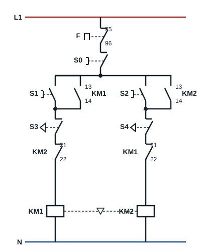

## Control circuit with limit switches

On a machine that moves a load (a goods lift, for example), two **limit switches** (butées de fin de course) are added to stop the motor when the load reaches the end of its travel.

| Code | Device |
|---|---|
| Q | Isolator |
| F | Thermal overload relay |
| S0 | Stop push button |
| S1 | Start push button, direction 1 |
| S2 | Start push button, direction 2 |
| S3, S4 | Two limit switches |
| KM1, KM2 | Main contactors |
| KM1 (13-14), KM2 (13-14) | Hold-in contacts |
| KM1 (21-22), KM2 (21-22) | Electrical interlock contacts |

Limit switches **S3** and **S4** are normally closed contacts. S3 is wired in series in the coil branch of **KM1**, S4 in the coil branch of **KM2**, before the electrical interlock contacts.

## Operation

- Pressing **S1** energises **KM1**: the motor runs in direction 1 and the load moves.
- When the load reaches limit switch **S3**, it opens: the KM1 coil is no longer supplied and the motor stops, even if nobody presses S0.
- While S3 stays operated, pressing S1 again has no effect. Only a start in direction 2, with **S2**, is possible; the load then moves away from S3.
- Limit switch **S4** does the same at the other end of travel, in direction 2.
- **S0** stops the motor at any time; thermal overload relay **F** stops it on an overload.

## Uses

Some applications of semi-automatic two-direction starting:

- lifts;
- goods lifts;
- motorised gates and doors;
- overhead cranes and conveyor carriages.
