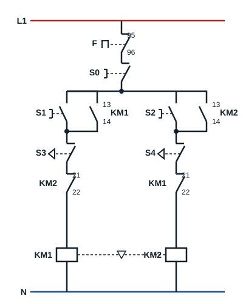

## Circuit de commande avec butées de fin de course

Sur une machine qui déplace une charge (un monte-charge par exemple), on ajoute deux **butées de fin de course** qui arrêtent le moteur quand la charge arrive en bout de course.

| Repère | Appareil |
|---|---|
| Q | Sectionneur |
| F | Relais thermique |
| S0 | Bouton poussoir arrêt |
| S1 | Bouton poussoir marche sens 1 |
| S2 | Bouton poussoir marche sens 2 |
| S3, S4 | Deux butées de fin de course |
| KM1, KM2 | Contacteurs principaux |
| KM1 (13-14), KM2 (13-14) | Contacts de maintien |
| KM1 (21-22), KM2 (21-22) | Contacts de verrouillage électrique |

Les butées **S3** et **S4** sont des contacts à ouverture. S3 est placée en série dans la branche de la bobine de **KM1**, S4 dans la branche de la bobine de **KM2**, avant les contacts de verrouillage électrique.

## Fonctionnement

- Un appui sur **S1** alimente **KM1** : le moteur tourne dans le sens 1 et la charge se déplace.
- Quand la charge atteint la butée **S3**, celle-ci s'ouvre : la bobine de KM1 n'est plus alimentée et le moteur s'arrête, même si personne n'appuie sur S0.
- Tant que S3 reste actionnée, un nouvel appui sur S1 n'a aucun effet. Seul un départ dans le sens 2, par **S2**, est possible ; la charge quitte alors la butée S3.
- La butée **S4** joue le même rôle à l'autre bout de la course, dans le sens 2.
- **S0** arrête le moteur à tout moment ; le relais thermique **F** l'arrête en cas de surcharge.

## Utilisation

Quelques domaines d'utilisation du démarrage semi-automatique deux sens de marche :

- les élévateurs (ascenseurs) ;
- les monte-charges ;
- les portails et portes motorisés ;
- les ponts roulants et les chariots de convoyeur.
