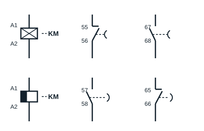

## Course outline

- Attendance and PPE check, safety instructions: 15 min
- Statement of the expected competences: 15 min
- Check of prerequisites: 30 min
- Practical scenario
- Theory: 1 hour
- Practice: 12 hours
- Assessment, tests, dismantling: 1 h 30 min
- Consolidation exercises (task): 30 min

## Expected competences

At the end of this sequence, the learner will be able to carry out the star-delta starting of three-phase induction motors.

## Check of prerequisites

### Different starting methods

There are several ways of starting three-phase induction motors, in particular:

- direct-on-line starting (one or two directions of rotation);
- star-delta starting;
- starting by cutting out rotor or stator resistors;
- electronic starting.

### Connecting motors

There are two ways of connecting three-phase induction motors, chosen according to the motor's characteristics and the supply (network voltage).

The course uses the former names of the 220/380 V and 380/660 V networks: they correspond to today's standard voltages (IEC 60038) **230/400 V** and **400/690 V**, found on the plates of recent motors. The reasoning stays the same.

- **Star connection**: on a 220/380 V three-phase supply, the voltage accepted by the star connection is 380 V; on a 380/660 V supply, it is 660 V.
- **Delta connection**: on a 220/380 V three-phase supply, the voltage accepted by the delta connection is 220 V; on a 380/660 V supply, it is 380 V.

**Note**: always look at the motor rating plate before connecting the windings.

## The timer relay

A timer relay (relais temporisé) is a device that opens or closes one or more contacts with a delay set by the user, either when it is energised (**on-delay**) or when it is de-energised (**off-delay**). It often comes as an add-on block that clips onto the front of a contactor, with a dial to set the delay (for example from 0.1 to 30 s).

There are:

- **the on-delay timer block** (bloc temporisé travail): timing starts when the coil is energised. The normally closed contact **55-56** opens and the normally open contact **67-68** closes once the delay has elapsed;
- **the off-delay timer block** (bloc temporisé repos): timing starts when the coil is de-energised. Its contacts (**57-58** and **65-66**) only return to their rest position once the delay has elapsed.

