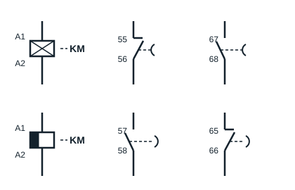

## Plan du cours

- Vérification des présences et du port des EPI, consignes de sécurité : 15 min
- Énoncé des compétences attendues : 15 min
- Vérification des prérequis : 30 min
- Mise en situation
- Contenu théorique : 1 heure
- Pratique : 12 heures
- Évaluation, tests, démontage : 1 h 30 min
- Exercices de consolidation (TAF) : 30 min

## Compétences attendues

Au sortir de cette séquence, l'apprenant sera capable de réaliser le démarrage étoile-triangle des moteurs asynchrones triphasés.

## Vérification des prérequis

### Différents procédés de démarrage

Il existe plusieurs procédés de démarrage des moteurs asynchrones triphasés, notamment :

- démarrage direct (un sens, deux sens de marche) ;
- démarrage étoile-triangle ;
- démarrage par élimination des résistances rotoriques ou statoriques ;
- démarrages électroniques.

### Couplage des moteurs

Il existe deux types de couplage des MAT (moteurs asynchrones triphasés), choisis en fonction des caractéristiques du moteur et de l'alimentation (tension du réseau).

Le support emploie les anciennes appellations des réseaux 220/380 V et 380/660 V : elles correspondent aux tensions normalisées aujourd'hui (IEC 60038) **230/400 V** et **400/690 V**, que l'on lit sur les plaques des moteurs récents. Le raisonnement reste le même.

- **Couplage étoile** : sur un réseau triphasé 220/380 V, la tension admise par le couplage étoile est de 380 V ; sur un réseau triphasé 380/660 V, elle est de 660 V.
- **Couplage triangle** : sur un réseau triphasé 220/380 V, la tension admise par le couplage triangle est de 220 V ; sur un réseau triphasé 380/660 V, elle est de 380 V.

**NB** : il faut toujours regarder la plaque signalétique du moteur avant de coupler les enroulements.

## Le relais temporisé

Un relais temporisé est un appareil qui doit, soit lors de son alimentation (temporisation **travail**), soit lors de sa coupure (temporisation **repos**), ouvrir ou fermer un ou plusieurs contacts avec un retard réglable par l'utilisateur. Il se présente souvent sous la forme d'un bloc additif qui se clipse sur la face avant d'un contacteur, avec une molette de réglage du retard (par exemple de 0,1 à 30 s).

On distingue :

- **le bloc temporisé travail** : la temporisation commence à la mise sous tension de la bobine. Le contact à ouverture **55-56** s'ouvre et le contact à fermeture **67-68** se ferme une fois le retard écoulé ;
- **le bloc temporisé repos** : la temporisation commence à la mise hors tension de la bobine. Ses contacts (**57-58** et **65-66**) ne reviennent à leur position de repos qu'une fois le retard écoulé.

