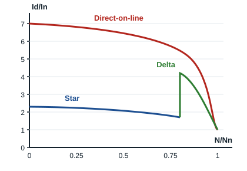

## Principle of star-delta starting

Star-delta starting is widely used to start three-phase induction motors. With direct-on-line starting, the current is 4 to 8 times the rated current. On large motors, these starting currents overload the supply lines (wires, terminals, cables) and the protective devices (fuses, isolator, thermal overload relay, etc.), which can destroy electrical parts of the installation.

The purpose of star-delta starting is to **reduce the inrush current** when the motor starts.

## Starting curves

The ratio Id/In compares the starting current Id with the rated current In, according to the motor speed N divided by its rated speed Nn:

- with **direct-on-line starting**, the current reaches about **7 In** at switch-on, then falls as the motor picks up speed;
- with **star starting**, each winding only receives the supply voltage divided by √3: the starting current is divided by 3, about **2.3 In**;
- on switching to **delta**, at about 75 to 85% of rated speed, the current rises briefly, then settles at the rated current.

The starting torque is also divided by 3 in star.

## Conditions for star-delta starting

- The **delta** connection must match the supply voltage: for example a 400/690 V motor on a 230/400 V supply.
- The motor must start in two steps:
  - **first step**: windings connected in star and switched on;
  - **second step**: star connection removed, immediately followed by the delta connection.
- **Time delay**: to switch automatically from Y to Δ, a timed contact is used which makes or breaks a contact after a preset time, so that the equipment works properly.

This starting method is therefore used for motors that run in **delta** in normal operation.
