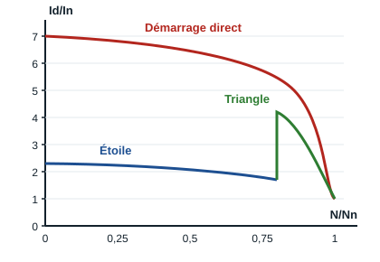

## Principe du démarrage étoile-triangle

Le démarrage étoile-triangle est très utilisé en électrotechnique pour la mise en route des moteurs asynchrones triphasés. En effet, lors d'un démarrage direct, l'intensité du courant est 4 à 8 fois le courant nominal. Sur les moteurs de grande puissance, ces courants de démarrage entraînent des surcharges sur les lignes d'alimentation (fils, bornes, câbles) et sur les appareils de protection (fusibles, sectionneur, relais thermique, etc.), ce qui peut entraîner la destruction des éléments et composants électriques de l'installation.

Le démarrage étoile-triangle a pour rôle de **réduire l'appel de courant** lors du démarrage du moteur.

## Courbes de démarrage

Le rapport Id/In compare le courant de démarrage Id au courant nominal In, en fonction de la vitesse du moteur N rapportée à sa vitesse nominale Nn :

- en **démarrage direct**, le courant atteint environ **7 In** à la mise sous tension, puis diminue à mesure que le moteur prend de la vitesse ;
- en **démarrage étoile**, chaque enroulement ne reçoit que la tension réseau divisée par √3 : le courant de démarrage est divisé par 3, environ **2,3 In** ;
- au passage en **triangle**, vers 75 à 85 % de la vitesse nominale, le courant remonte brièvement puis rejoint le courant nominal.

Le couple de démarrage est lui aussi divisé par 3 en étoile.

## Conditions à remplir pour un démarrage étoile-triangle

- Le couplage **triangle** doit correspondre à la tension du réseau : un moteur 400/690 V sur un réseau 230/400 V, par exemple.
- Le démarrage du moteur doit se faire en deux temps :
  - **premier temps** : couplage des enroulements en étoile et mise sous tension ;
  - **deuxième temps** : suppression du couplage étoile, immédiatement suivie du couplage triangle.
- **Temporisation** : pour réaliser la commutation automatique du couplage Y au couplage Δ, on utilise un contact temporisé qui établit ou ouvre un contact après un temps préréglé, de façon à permettre un fonctionnement convenable de l'équipement.

Ce type de démarrage est donc utilisé pour des moteurs couplés en **triangle** lors de leur fonctionnement normal.
