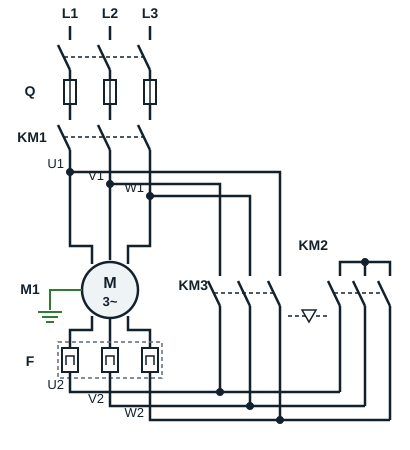
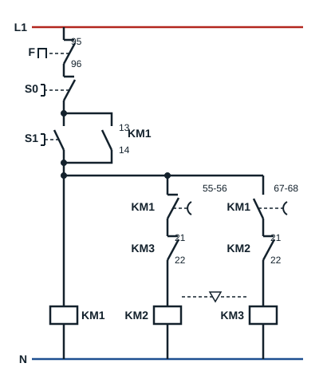

## Power circuit

| Code | Device |
|---|---|
| L1, L2, L3 | Three-phase supply |
| Q | Fuse switch-disconnector |
| F | Thermal overload relay |
| KM1 | Line contactor |
| KM2 | Star contactor |
| KM3 | Delta contactor |
| M1 | Three-phase induction motor |

**KM1** brings phases L1, L2, L3 to motor terminals U1, V1, W1; it stays closed throughout operation. The links on the terminal board are removed: the connections are made by the contactors.

- **KM2** (star) joins terminals U2, V2, W2 together: it forms the star point.
- **KM3** (delta) connects U2 to V1, V2 to W1 and W2 to U1: each winding ends up between two phases.

KM2 and KM3 must never be closed at the same time: that would be a phase-to-phase short circuit. They are joined by a **mechanical interlock** (▽ symbol) and by an electrical interlock.

Thermal overload relay **F** is placed in the winding loop, between terminals U2, V2, W2 and contactors KM2 and KM3. It therefore carries the current of one winding, not the line current: it is set to In / √3, about 0.58 times the rated delta current read on the plate.

## Control circuit

| Code | Device |
|---|---|
| L1, N | Single-phase supply of the control circuit |
| Q | Fuse switch-disconnector (early-break contact) |
| F | Thermal overload relay (contact 95-96) |
| S0 | Stop push button |
| S1 | Start push button |
| KM1 (13-14) | Hold-in contact of KM1 |
| KM1 (55-56), KM1 (67-68) | Contacts of the on-delay timer block fitted on KM1 |
| KM2 (21-22), KM3 (21-22) | Electrical interlock contacts between star and delta |
| KM1 | Line contactor |
| KM2 | Star contactor |
| KM3 | Delta contactor |

After F, S0 and S1 (in parallel with hold-in contact KM1 13-14), three branches are supplied:

1. the coil of **KM1**;
2. timed contact **55-56** of KM1, then contact **21-22 of KM3**, then the coil of **KM2**;
3. timed contact **67-68** of KM1, then contact **21-22 of KM2**, then the coil of **KM3**.

## How it works

**First step**: the windings are connected in star, so each winding receives a reduced voltage.

With the circuit live and the isolator closed, pressing **S1** energises the coil of **KM1**, which holds itself in through its contact 13-14. Timed contact 55-56, still closed, energises the coil of **KM2** at the same time: the motor starts in **star**. The timer block fitted on KM1 starts timing.

**Second step**: the star connection is removed, then the motor windings are connected in delta.

When the delay has elapsed, contact **55-56** opens and de-energises **KM2**. Contact 21-22 of KM2 closes again; contact **67-68** closes and energises the coil of **KM3**: the motor runs in **delta**. Contact 21-22 of KM3, now open, stops KM2 from closing again.

The motor stops when **S0** is pressed, or when contact 95-96 of thermal overload relay **F** opens on an overload: all the coils drop out.

## Advantages and drawbacks of star-delta starting

**Advantages**

- Fairly cheap starter
- Lower starting current than direct-on-line starting, so less disturbance on the supply

**Drawbacks**

- Low starting torque
- Break in current and high transient currents when switching from star to delta

**Use**: mainly for machines that start with no load (fans, centrifugal pumps, compressors unloaded at start-up).
