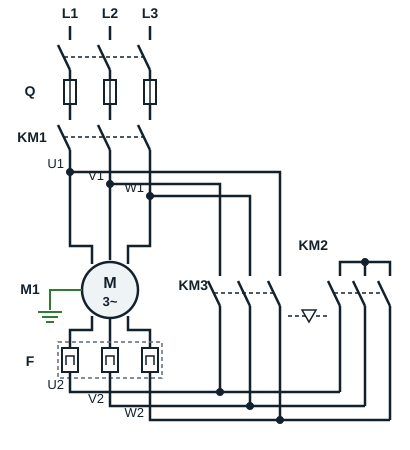
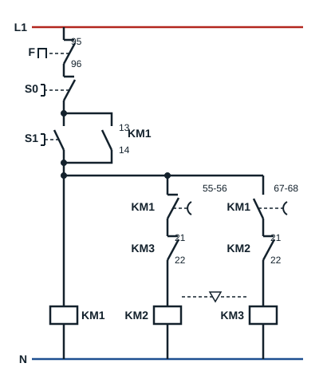

## Circuit de puissance

| Repère | Appareil |
|---|---|
| L1, L2, L3 | Alimentation triphasée |
| Q | Sectionneur porte-fusibles |
| F | Relais thermique |
| KM1 | Contacteur de ligne |
| KM2 | Contacteur étoile |
| KM3 | Contacteur triangle |
| M1 | Moteur asynchrone triphasé |

**KM1** amène les phases L1, L2, L3 aux bornes U1, V1, W1 du moteur ; il reste fermé pendant tout le fonctionnement. Les barrettes de la plaque à bornes sont retirées : les couplages se font au niveau des contacteurs.

- **KM2** (étoile) relie entre elles les bornes U2, V2, W2 : il forme le point neutre de l'étoile.
- **KM3** (triangle) relie U2 à V1, V2 à W1 et W2 à U1 : chaque enroulement se retrouve entre deux phases.

KM2 et KM3 ne doivent jamais être fermés en même temps : ce serait un court-circuit entre phases. Ils sont liés par un **verrouillage mécanique** (symbole ▽) et par un verrouillage électrique.

Le relais thermique **F** est placé dans la boucle des enroulements, entre les bornes U2, V2, W2 et les contacteurs KM2 et KM3. Il est donc traversé par le courant d'un enroulement, et non par le courant de ligne : il se règle à In / √3, soit environ 0,58 fois le courant nominal lu sur la plaque en triangle.

## Circuit de commande

| Repère | Appareil |
|---|---|
| L1, N | Alimentation monophasée du circuit de commande |
| Q | Sectionneur porte-fusibles (contact de pré-coupure) |
| F | Relais thermique (contact 95-96) |
| S0 | Bouton poussoir arrêt |
| S1 | Bouton poussoir marche |
| KM1 (13-14) | Contact d'auto-maintien de KM1 |
| KM1 (55-56), KM1 (67-68) | Contacts du bloc temporisé travail monté sur KM1 |
| KM2 (21-22), KM3 (21-22) | Contacts de verrouillage électrique entre étoile et triangle |
| KM1 | Contacteur de ligne |
| KM2 | Contacteur étoile |
| KM3 | Contacteur triangle |

Après F, S0 et S1 (en parallèle avec le maintien KM1 13-14), trois branches sont alimentées :

1. la bobine de **KM1** ;
2. le contact temporisé **55-56** de KM1, puis le contact **21-22 de KM3**, puis la bobine de **KM2** ;
3. le contact temporisé **67-68** de KM1, puis le contact **21-22 de KM2**, puis la bobine de **KM3**.

## Principe de fonctionnement

**1er temps** : les enroulements sont couplés en étoile, la tension est réduite aux bornes de chaque enroulement.

Le circuit étant sous tension et le sectionneur fermé, l'impulsion sur **S1** alimente la bobine de **KM1**, qui s'auto-maintient par son contact 13-14. Le contact temporisé 55-56, encore fermé, alimente en même temps la bobine de **KM2** : le moteur démarre en **étoile**. La temporisation du bloc monté sur KM1 commence.

**2e temps** : suppression du couplage étoile, puis couplage des enroulements du moteur en triangle.

Après la temporisation, le contact **55-56** s'ouvre et met hors tension **KM2**. Le contact 21-22 de KM2 se referme ; le contact **67-68** se ferme et alimente la bobine de **KM3** : c'est le fonctionnement en **triangle**. Le contact 21-22 de KM3, désormais ouvert, empêche KM2 de se refermer.

L'arrêt est obtenu par **S0**, ou par le contact 95-96 du relais thermique **F** en cas de surcharge : toutes les bobines retombent.

## Avantages et inconvénients du démarrage étoile-triangle

**Avantages**

- Démarreur relativement peu coûteux
- Courant de démarrage plus faible qu'en démarrage direct, donc moins de perturbations sur le réseau

**Inconvénients**

- Couple de démarrage faible
- Coupure de courant et courants transitoires importants au passage étoile-triangle

**Utilisation** : réservé essentiellement aux machines démarrant à vide (ventilateurs, pompes centrifuges, compresseurs déchargés au démarrage).
