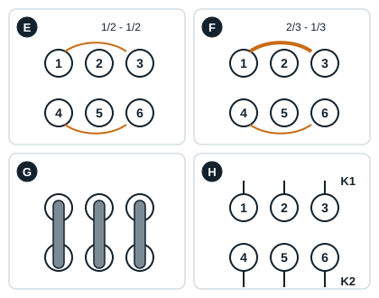
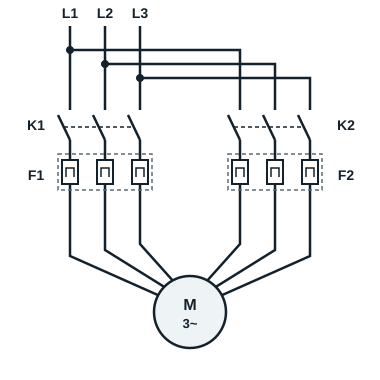
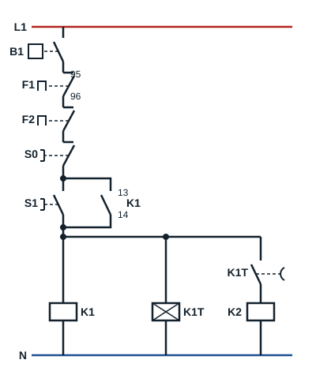

## Identifying a 50% / 50% part-winding motor

Winding diagrams are usually supplied. If not, the 6 terminals of the motor terminal block must be identified with an ohmmeter, with no voltage applied:

- the resistances of winding no. 1, between U1, V1, W1, are equal;
- the resistances of winding no. 2, between U2, V2, W2, are equal;
- the resistances of both windings are equal.

## Identifying a 66% / 33% part-winding motor

- The resistances of winding no. 1 (66%), between U1, V1, W1, are equal.
- The resistances of winding no. 2 (33%), between U2, V2, W2, are equal.
- The resistances of the first winding (U1, V1, W1) are **lower** than those of the second (U2, V2, W2): the more powerful a winding, the lower its resistance.

## The terminal boards

On the terminal block numbered 1 to 6:

| Case | What you measure or wire |
|---|---|
| E: windings 1/2 - 1/2 | Resistances 1-2, 2-3, 3-1, 4-5, 5-6, 6-4 equal |
| F: windings 2/3 - 1/3 | Resistances 1-2, 2-3, 3-1 lower than 4-5, 5-6, 6-4 |
| G: one contactor, direct-on-line start at 400 V | Three links join 1 to 4, 2 to 5 and 3 to 6: both windings are in parallel |
| H: two contactors, part-winding start | No links: terminals 1, 2, 3 go to contactor K1, terminals 4, 5, 6 to contactor K2 |

## Part-winding starter circuit

| Code | Device |
|---|---|
| K1 | Contactor of the 1st winding |
| K2 | Contactor of the 2nd winding (delayed) |
| K1T | Timer for K2 |
| F1, F2 | Thermal protection of each winding |
| B1 | Overheating protection module, connected to the PTC sensors in the windings |

**Power circuit**: L1, L2, L3 supply the first winding (1U, 1V, 1W) through **K1** and thermal overload relay **F1**, and the second winding (2U, 2V, 2W) through **K2** and thermal overload relay **F2**. Both outputs keep the same phase order, so that the two windings turn in the same direction.

**Control circuit**: the contact of protection module **B1**, then contacts 95-96 of F1 and F2, are in series at the head of the circuit. Starting energises **K1** and timer **K1T**; at the end of the delay (1 s at most), the K1T contact energises **K2**. A thermal fault on either winding, or overheating detected by the sensors, stops the whole motor.
