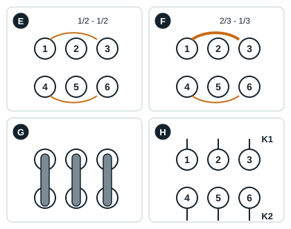
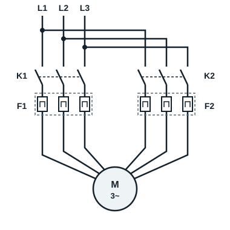
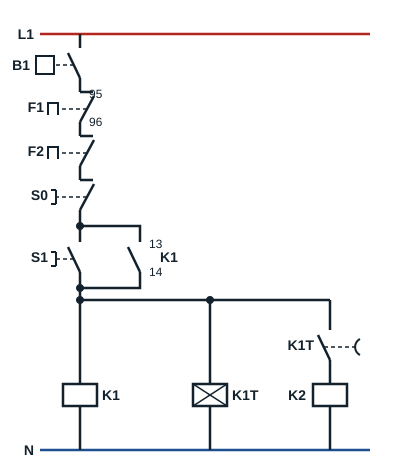

## Repérage d'un moteur fractionné à 50 % / 50 %

Les schémas de câblage des enroulements sont généralement fournis. Dans le cas contraire, un repérage des 6 bornes du bornier du moteur s'impose, à l'ohmmètre et hors tension :

- les résistances des enroulements n° 1, entre U1, V1, W1, sont identiques ;
- les résistances des enroulements n° 2, entre U2, V2, W2, sont identiques ;
- les résistances des deux enroulements sont identiques.

## Repérage d'un moteur fractionné à 66 % / 33 %

- Les résistances des enroulements n° 1 (66 %), entre U1, V1, W1, sont identiques.
- Les résistances des enroulements n° 2 (33 %), entre U2, V2, W2, sont identiques.
- Les résistances du premier bobinage (U1, V1, W1) sont **inférieures** à celles du deuxième (U2, V2, W2) : plus un enroulement est puissant, plus sa résistance est faible.

## Les plaques à bornes

Sur le bornier numéroté de 1 à 6 :

| Cas | Ce que l'on mesure ou ce que l'on câble |
|---|---|
| E : bobinages 1/2 - 1/2 | Résistances 1-2, 2-3, 3-1, 4-5, 5-6, 6-4 identiques |
| F : bobinages 2/3 - 1/3 | Résistances 1-2, 2-3, 3-1 inférieures à 4-5, 5-6, 6-4 |
| G : un contacteur, démarrage direct en 400 V | Trois barrettes relient 1 à 4, 2 à 5 et 3 à 6 : les deux bobinages sont en parallèle |
| H : deux contacteurs, démarrage fractionné | Aucune barrette : les bornes 1, 2, 3 vont au contacteur K1, les bornes 4, 5, 6 au contacteur K2 |

## Schéma de démarrage fractionné

| Repère | Appareil |
|---|---|
| K1 | Contacteur du 1er enroulement |
| K2 | Contacteur du 2e enroulement (temporisé) |
| K1T | Temporisation de K2 |
| F1, F2 | Protection thermique de chaque enroulement |
| B1 | Module de protection contre la surchauffe, relié aux sondes PTC des enroulements |

**Circuit de puissance** : L1, L2, L3 alimentent, par **K1** et le relais thermique **F1**, le premier enroulement (1U, 1V, 1W) ; par **K2** et le relais thermique **F2**, le second enroulement (2U, 2V, 2W). Les deux départs gardent le même ordre des phases, pour que les deux bobinages tournent dans le même sens.

**Circuit de commande** : le contact du module de protection **B1**, puis les contacts 95-96 de F1 et de F2, sont en série en tête du circuit. La mise en marche alimente **K1** et le temporisateur **K1T** ; à la fin de la temporisation (1 s au maximum), le contact de K1T alimente **K2**. Un défaut thermique sur l'un des deux enroulements, ou une surchauffe détectée par les sondes, arrête tout le moteur.
