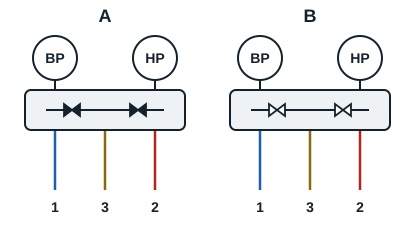

To carry out a task on a system, the refrigeration fitter needs a set of tools.

## The manifold

A manifold gauge set (jeu de manifolds) reads the pressures and temperatures (HP and BP) of a refrigeration circuit. It consists of two pressure gauges (HP and BP), three or four hoses depending on the model, and two or four service bypass valves. There are three-way and four-way manifolds. Keep small solid objects out of it.

- **A, reading**: to read the pressure in the system (HP or BP side), close the bypass valve.
- **B, evacuation**: open all the valves.
- **Charging** with refrigerant (HP or BP side): close one valve and leave the other connected to the centre port.

The manifold reads relative pressure, that is, the difference from atmospheric pressure. It is graduated in bar. Electronic manifolds also exist.

## The vacuum pump

This tool removes impurities from the refrigeration circuit (moisture, air) by going below atmospheric pressure. To guarantee its performance, always check the oil level in the pump.

## The vacuum gauge

A vacuum gauge (vacuomètre) reads the pressure of the vacuum (absolute pressure). It is graduated in mbar or pascal. It is fitted between the manifold and the pump, and is often built into some vacuum pumps.
