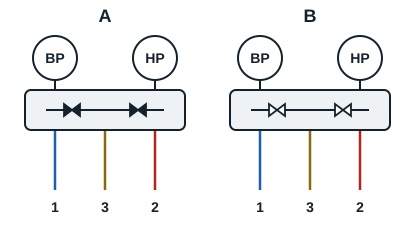

Pour effectuer une tâche sur une installation, le frigoriste doit se munir d'un ensemble d'outils.

## Le manifold

C'est un outil qui permet de lire les différentes pressions et températures (HP et BP) d'un circuit frigorifique. Il est composé de deux manomètres (HP et BP), de trois ou quatre flexibles (en fonction du manifold), de deux ou quatre vannes de bipasse de service. Il existe des manifolds à trois voies et à quatre voies. Éviter d'y introduire de petits objets solides.

- **A, lecture** : pour lire la pression régnant dans l'installation (en HP ou en BP), il faut fermer la vanne bipasse.
- **B, tirage au vide** : il faut ouvrir toutes les vannes.
- **Charge** en fluide frigorigène (en HP ou en BP) : fermer l'une des vannes et laisser l'autre communiquer avec l'orifice du milieu.

Le manifold permet la lecture de la pression relative, c'est-à-dire de l'écart avec la pression atmosphérique. Il est gradué en bar. Il existe aussi des manifolds électroniques.

## La pompe à vide

C'est un outil qui permet d'extraire les impuretés du circuit frigorifique (l'humidité, l'air), en descendant sous la pression atmosphérique. Pour garantir sa performance, il faut toujours vérifier le niveau d'huile dans la pompe.

## Le vacuomètre

C'est un outil qui permet de lire la pression du vide (pression absolue). Il est gradué en mbar ou en pascal. Il se monte entre le manifold et la pompe, et il est souvent monté sur certaines pompes à vide.
