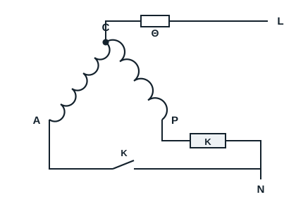
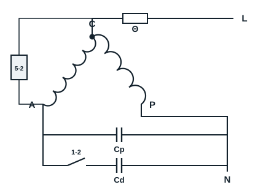

Single-phase motor-compressors start with a current relay, a voltage relay, a PTC or a capacitor. Three-phase motor-compressors start without any device on an auxiliary winding (see the section on three-phase).

## Starting with a current relay

This relay is generally used on small single-phase motor-compressors, below 500 W. Its coil is in series with the main winding; its contact, open at rest, is in series with the auxiliary winding.

**Operation**: on switching on (230 V), the run winding and the relay coil carry a high current. This current peak closes the relay contact, which energises the start winding. The motor starts; as it reaches speed, the current falls, the contact opens and the start winding is de-energised.

## Starting with a voltage relay

Voltage relays (relais de tension) are used on larger motors, from about 600 W: the current would be too high for a current relay, whose coil would need far too thick a wire. The voltage relay has a coil, connected to terminals 2 and 5, and a contact closed at rest, between terminals 1 and 2, in series with the start capacitor.

**Operation**:

- at rest the relay coil is not energised and the contact is closed;
- on switching on, the main and auxiliary windings and the relay coil are energised, and the motor starts;
- during starting, the voltage across the auxiliary winding and the coil rises with motor speed;
- at normal speed, the induced voltage across the coil becomes high enough to open the contact, and stays so while running.
