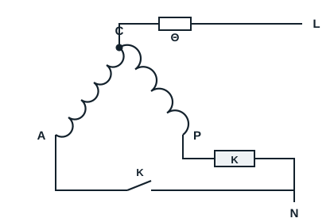
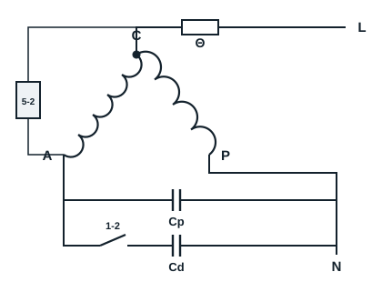

Les moto-compresseurs monophasés démarrent par relais d'intensité, par relais de tension, par CTP ou par condensateur. Les moto-compresseurs triphasés démarrent sans dispositif sur l'enroulement auxiliaire (voir la section consacrée au triphasé).

## Démarrage par relais d'intensité

Ce relais est généralement utilisé sur des moto-compresseurs monophasés de petite puissance, inférieure à 500 W. Sa bobine est en série avec l'enroulement principal ; son contact, ouvert au repos, est en série avec l'enroulement auxiliaire.

**Fonctionnement** : à la mise sous tension (230 V), l'enroulement de marche et la bobine du relais sont parcourus par un courant important. Cette pointe d'intensité fait fermer le contact du relais, qui met sous tension l'enroulement de démarrage. Le moteur démarre ; lorsqu'il atteint sa vitesse, l'intensité diminue, ce qui ouvre le contact et met hors tension l'enroulement de démarrage.

## Démarrage par relais de tension

Les relais de tension sont utilisés sur des moteurs plus puissants, à partir de 600 W environ : le courant y serait trop fort pour un relais d'intensité, dont la bobine devrait avoir un fil bien trop gros. Le relais de tension est constitué d'une bobine, raccordée aux bornes 2 et 5, et d'un contact fermé au repos, entre les bornes 1 et 2, en série avec le condensateur de démarrage.

**Fonctionnement** :

- à l'arrêt, la bobine du relais n'est pas sous tension et le contact est fermé ;
- à la mise sous tension, les enroulements principal et auxiliaire et la bobine du relais sont alimentés, et le moteur démarre ;
- au démarrage, la tension aux bornes de l'enroulement auxiliaire et de la bobine augmente avec la vitesse du moteur ;
- à la vitesse normale, la tension induite aux bornes de la bobine devient suffisante pour ouvrir le contact, et elle reste suffisante pendant le fonctionnement.
