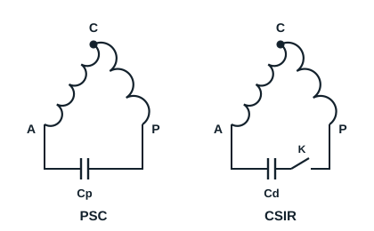

## Starting with a PTC (positive temperature coefficient)

This starting method is used on small motors, below about 500 W, on hermetic motor-compressors needing low starting torque.

**Operation**: at starting the PTC has a low resistance, so both windings are supplied and the motor starts. The current heats the PTC, whose resistance rises sharply, isolating the start winding. While running, the PTC behaves like an open switch.

## Starting with a capacitor

A capacitor is placed in series with the auxiliary winding to create a phase shift (second phase) and give the required starting torque.

| Circuit | Capacitor | Use |
|---|---|---|
| PSC (permanent split capacitor) | Cp stays in service while running | Low starting torque, capillary tube, pressures equalised at rest |
| CSIR (capacitor start, induction run) | Cd cut out by a relay once the motor has started | High starting torque, for example a circuit with a thermostatic expansion valve |
| CSR (capacitor start, capacitor run) | Cd for starting, Cp for running | High starting torque and good running efficiency |

In the CSIR circuit it is the relay that cuts out the start capacitor once speed is reached: a capacitor on alternating current passes current and never behaves as an open switch.

**Identifying capacitors**: rely on the marking rather than the colour. The start capacitor (condensateur de démarrage) has a large capacitance (for example 100 µF) and a start rating; the run capacitor has a lower capacitance and a continuous-duty rating. Both show their maximum voltage, which must be at least that of the supply.

[[figure:demarrage-compresseur]]
