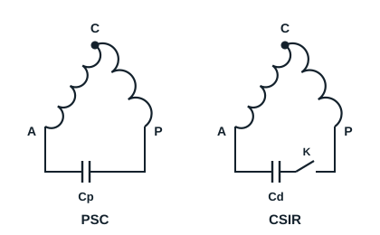

## Démarrage par CTP (coefficient de température positive)

Ce type de démarrage est utilisé sur des moteurs de faible puissance, moins de 500 W environ, sur des moto-compresseurs hermétiques qui demandent un faible couple de démarrage.

**Fonctionnement** : au démarrage, la CTP présente une faible résistance, ce qui permet d'alimenter les deux enroulements, et le moteur démarre. Le courant absorbé échauffe la CTP, dont la résistance augmente fortement, ce qui isole l'enroulement de démarrage. Pendant la marche, la CTP se comporte comme un interrupteur ouvert.

## Démarrage par condensateur

On utilise un condensateur en série avec l'enroulement auxiliaire, pour créer un déphasage (seconde phase) et obtenir le couple de démarrage désiré.

| Montage | Condensateur | Usage |
|---|---|---|
| PSC (condensateur permanent) | Cp reste en service pendant la marche | Faible couple de démarrage, détendeur capillaire, pressions égalisées à l'arrêt |
| CSIR (démarrage par condensateur) | Cd mis hors service par un relais dès que le moteur a démarré | Couple de démarrage élevé, par exemple circuit avec détendeur thermostatique |
| CSR (démarrage et marche) | Cd au démarrage, Cp en marche | Fort couple de démarrage et bon rendement en marche |

Dans le montage CSIR, c'est le relais qui coupe le condensateur de démarrage une fois la vitesse atteinte : un condensateur alimenté en courant alternatif laisse passer le courant et ne se comporte jamais comme un interrupteur ouvert.

**Reconnaître les condensateurs** : se fier au marquage plutôt qu'à la couleur. Le condensateur de démarrage porte une grande capacité (par exemple 100 µF) et la mention de démarrage ; le condensateur permanent porte une capacité plus faible et la mention de service continu. Les deux indiquent leur tension maximale, qui doit être au moins égale à celle du réseau.

[[figure:demarrage-compresseur]]
