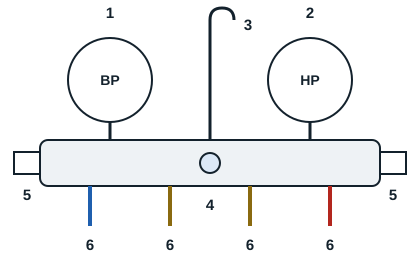

The manifold is the refrigeration technician's most important tool: it is used to diagnose a refrigeration system and to work on it.

It has two pressure gauges, high pressure in red and low pressure in blue, that read the pressures of the refrigerant used. It has a central body of brass or alloy that connects the various parts. Threaded connections, the service ports, take the hoses. Service valves, or plug valves, on either side, link the ports together. Between the valves is a sight glass. A removable metal hook lets the manifold hang on any support.

| Reference | Item |
|---|---|
| 1 | BP gauge (blue) |
| 2 | HP gauge (red) |
| 3 | Removable hook |
| 4 | Sight glass |
| 5 | Service valves |
| 6 | Service ports: BP, recovery, charging, HP |

There are two types of manifold gauge set (manifold): mechanical and electronic.
