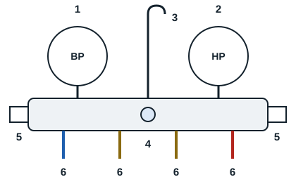

Le manifold est l'outil le plus important du technicien frigoriste : il sert à diagnostiquer une installation frigorifique et à intervenir dessus.

Il est constitué de deux manomètres, haute pression en rouge et basse pression en bleu, qui permettent de lire les pressions du fluide utilisé. Il se compose d'une partie centrale en laiton ou en alliage, qui forme le corps et met en relation les différents organes. Des raccords filetés, appelés voies de service, permettent de raccorder les flexibles. Des vannes de service, ou vannes à boisseau, situées de part et d'autre, assurent la communication entre elles. Entre les vannes se trouve un voyant de contrôle. Un crochet amovible en métal permet de suspendre le manifold à tout support.

| Repère | Élément |
|---|---|
| 1 | Manomètre BP (bleu) |
| 2 | Manomètre HP (rouge) |
| 3 | Crochet amovible |
| 4 | Voyant de contrôle |
| 5 | Vannes de service |
| 6 | Raccords de service : BP, récupération, charge, HP |

Il existe deux types de manifolds : le mécanique et l'électronique.
