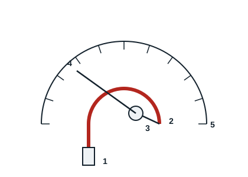

## The Bourdon tube system

A small-diameter curved metal tube is subjected to the pressure to be measured. It deforms as the pressure rises or falls. These movements are passed mechanically through a link and a toothed sector to a needle that moves in front of a graduated dial.

## The oil-filled system

The gauge is filled with a liquid (silicone or glycerine) that damps needle movement caused by compressor vibration, lengthens the life of the instrument and makes reading easier. These two systems are mechanical manifolds.

## The electronic system

The electronic manifold uses a pressure transducer. It works with any refrigerant thanks to the refrigerants stored in its memory. It gives precise pressure and temperature readings, logs data and produces reports, updates with new refrigerants, measures vacuum reliably and has built-in temperature probes. Readings stay safe when the cycle reverses.
