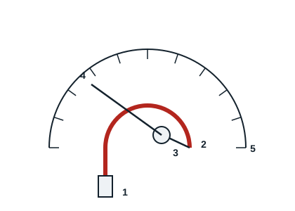

## Le système à tube de Bourdon

Un tube en métal de petit diamètre, de forme circulaire, est soumis à la pression à mesurer. Il se déforme sous l'action de la pression qui augmente ou diminue. Ces mouvements sont transmis mécaniquement par une biellette et une roue dentée à une aiguille, qui se déplace devant un cadran gradué.

## Le système à bain d'huile

Le manomètre est rempli d'un liquide (silicone ou glycérine) qui amortit les mouvements de l'aiguille causés par les vibrations des compresseurs, prolonge la durée de vie de l'appareil et facilite la lecture. Ces deux systèmes correspondent au manifold mécanique.

## Le système électronique

Le manifold électronique utilise un capteur de pression. Il s'utilise sur tout type de fluide frigorigène grâce aux fluides mis en mémoire dans l'appareil. Il donne une lecture précise des pressions et des températures, enregistre les données et produit des rapports, se met à jour avec les nouveaux fluides, mesure le vide de façon fiable et intègre des sondes de température. La lecture reste sûre lors de l'inversion de cycle.
